# 銀色匕首之謎（Secret of the Silver Blades）繁體中文化

以 [dosgolem](https://github.com/wicanr2/dosgolem) 執行 SSI 1990 年 DOS 版《Secret of the Silver Blades》1.30，
在執行期攔截原版輸出並覆繪繁體中文。原版程式、資料與存檔保持原樣，需自備原版。

現況見 [CONTEXT.md](CONTEXT.md)，工作項目見
[GitHub Issues](https://github.com/wicanr2/secret-of-the-silver-blades-cht/issues)，協作規則見 [AGENTS.md](AGENTS.md)。

## 遊戲介紹

《Secret of the Silver Blades》是 SSI 依 AD&D 規則製作的角色扮演遊戲，屬於 Forgotten Realms 系列的 Gold Box 作品，
接在《光芒之池》與《青色枷的詛咒》之後。玩家帶領六人隊伍，在第一人稱 3D 畫面中探索城鎮、廢墟、礦坑與城堡，
遇敵時切換成俯視的戰術地圖，逐一對隊員下達移動、攻擊與施法指令。

劇情多半不印在畫面上。遊戲在關鍵時刻只顯示「你們把它記在手札第 N 則」，玩家要翻隨盒附的冒險者手札才讀得到對話與線索；
開始冒險前還要回答查驗題，例如「旅行手札第 18 則的第 4 個字」。軟體世界珍藏版 056 附有中文說明書，但手札有不少錯譯。
本中文化依 SSI 英文版手札逐則校正譯文，劇情引用時直接在遊戲內開啟手札，查驗題的答案也顯示在問句下方，不必再查說明書。

## 故事背景

三百年前，這座山谷住著一對兄弟：聖騎士奧斯沃夫與法師艾達瑪，兩人都敬拜正義之神提爾。艾達瑪年紀愈大愈想長生不老，
把自己關在孿生城堡頂樓修練巫妖之術，最後成了巫妖「恐怖魔王」。奧斯沃夫找來十二名英雄，組成「銀刃」討伐弟弟。
維地格里城在苦戰中化為廢墟，銀刃把恐怖魔王逼回城堡，法師與牧師施法把整座山谷封進冰河。奧斯沃夫在施法時為保護同伴倒下，
銀刃只剩一人活下來，留在提爾神殿守望。

故事開始時，你們在新維地格里城鎮長普里安的家裡醒來，頭昏腦脹，身上沒有任何裝備。鎮民向知識之井祈求勇士，井就把你們送來了。
這座礦工小鎮三個月前打開一座新礦坑，怪物從地底一層接著一層湧出，殺了不少礦工；知識之井也像是被某種力量控制住。
鎮長還提到附近有一群叫黑圈幫的法師，看起來不足為懼，其中一位甚至在鎮上賣魔法物品。

隨著調查深入，知識之井透露黑圈幫的真正目的：他們想喚醒冰封在城堡裡的恐怖魔王，正從地下城往上融出一條路，
困在地底的怪物因此被放了出來。恐怖魔王也在尋找艾達瑪的護身符，只要有人把它帶進城堡下方的地下城，他就能甦醒。
隊伍要深入礦坑、冰河裂縫與孿生城堡，接下銀刃的旗幟。

出處：遊戲開場劇情（`text/ecl-text.zh-TW.tsv`）與手札第 18、25、26、37 則（`text/journal.zh-TW.tsv`），內容經改寫。

## 成果

| 項目 | 內容 |
|---|---|
| 中文化 | 遊戲內文字覆繪繁體中文：介面 935、劇情 1,498、名稱 868、組句模板 187 筆；預建與自建隊員名自動音譯 |
| 手札 | 72 則旅行手札依英文原版校正珍056 譯文（錯譯 113 條，`text/errata.tsv`），劇情引用時自動開啟，F5 翻閱已讀過的手札；12 則地圖手札在本機完整版顯示中文標籤的圖面 |
| 說明書 | 珍056 上下冊逐頁校讀，規則書錯譯 7 條另列（`text/errata-manual.tsv`） |
| 查驗題 | 30 題答案表，問句下直接顯示答案（F9 切換） |
| 攻略與地圖 | 《軟體世界》第 21–25 期攻略 40 段（F6）；地圖疊層顯示走過的格子與 17 個地區名稱，8 張地圖標上 298 個攻略點（F7） |
| HD 重繪 | 1,735 項：標題、場景圖、頭像、戰鬥圖塊、3D 牆面與天空，只在 3 倍畫面顯示；重繪圖由 AI 生成 |
| 配樂 | 原版只有標題曲。以標題曲動機新編 13 首 OPL2 配樂，依地區與戰鬥切換（F4）；原版 AdLib 音效照常 |
| 多語系 | 繁中、简中、日本語、한국어、English，第一次啟動依系統語言，F8 切換 |
| 作弊 | 我方無敵（F1，預設關）：HP 不減少，昏迷、中毒等不良狀態會被解除 |
| 切換列 | 滑鼠移到視窗頂端出現，點項目等同按對應的鍵；遊戲速度 1x–32x、字級小中大三段只在這裡調整 |
| 發行包 | Linux AppImage、Windows、macOS 三平台，各有原版與原版加 HD 兩種；打包腳本與冒煙已完成，尚未公開發行（規格 012） |

原版程式不做任何修改，中文、HD 與配樂都在執行時疊加；切換列或 F12 可隨時切回英文原版對照。

## 畫面

以下是 dosgolem 執行原版並覆繪中文後的 2 倍畫面。手札、鎮上與攻略取自手札收據 `tools/g7-journal-receipt.sh`
（[docs/re/007](docs/re/007-g6-diagnostic-coverage.md)），地圖取自 `tools/g8-map-guide-receipt.sh`
（[docs/re/009](docs/re/009-map-overlay.md)），手札地圖頁取自 `tools/g7-journal-maps-receipt.sh`
（[規格 022](docs/spec/022-journal-maps.md)），查驗題取自診斷路徑的探針。

| | |
|---|---|
| 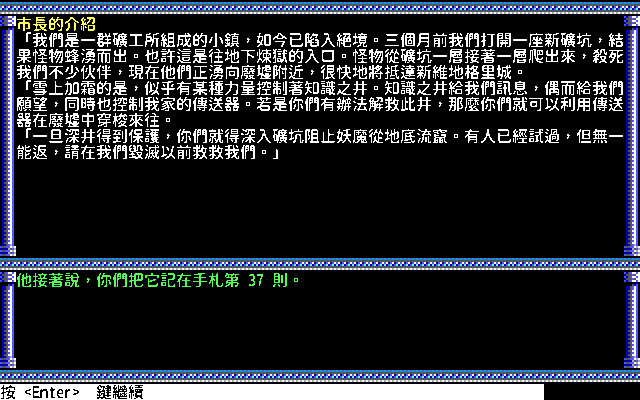 | 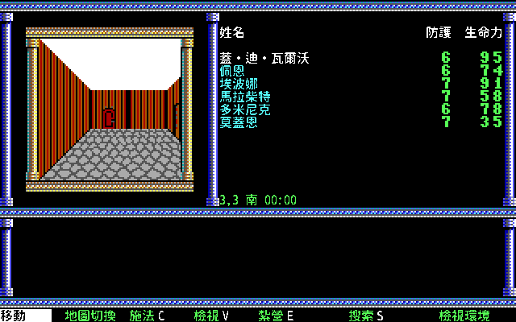 |
| 鎮長說完話，手札第 37 則自動彈出 | 新維地格里城 3D 畫面、隊員名音譯與底列選單 |
| 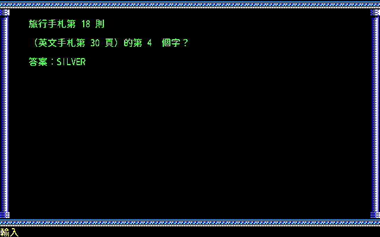 | 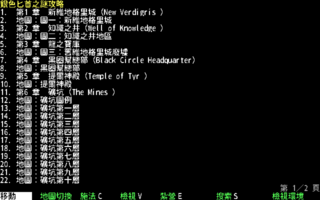 |
| 查驗題，問句下顯示答案（F9 切換） | 遊戲內攻略目錄（F6，《軟體世界》雜誌） |
| 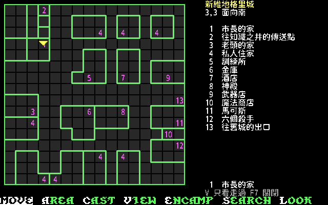 | 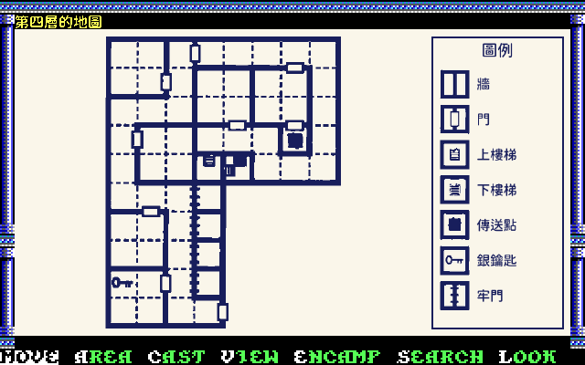 |
| 鎮上全圖與攻略點（F7，V 切換全圖） | 地圖手札第 32 則的中文圖面（本機完整版） |

### 3 倍與 HD 重繪

3 倍畫面（F2 切換）。標題與切換列取自發行包冒煙（Linux AppImage，`tools/release/smoke-toolbar.sh`），
其餘取自推廣片錄製（`cmd/sosb-promo`，[規格 016](docs/spec/016-promo-video.md)）。

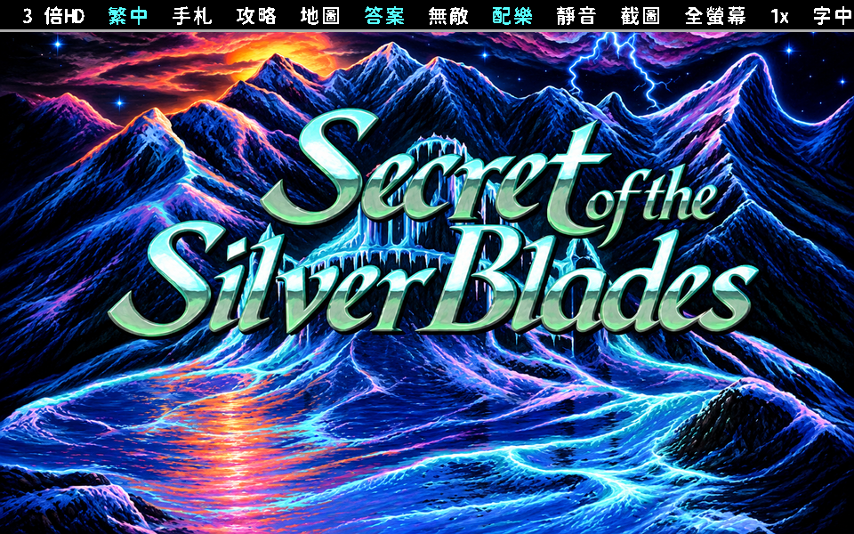

標題 HD 重繪，頂端是切換列：倍率、語言、手札、攻略、地圖、答案、無敵、配樂、靜音、截圖、全螢幕、速度、字級。

| | |
|---|---|
| 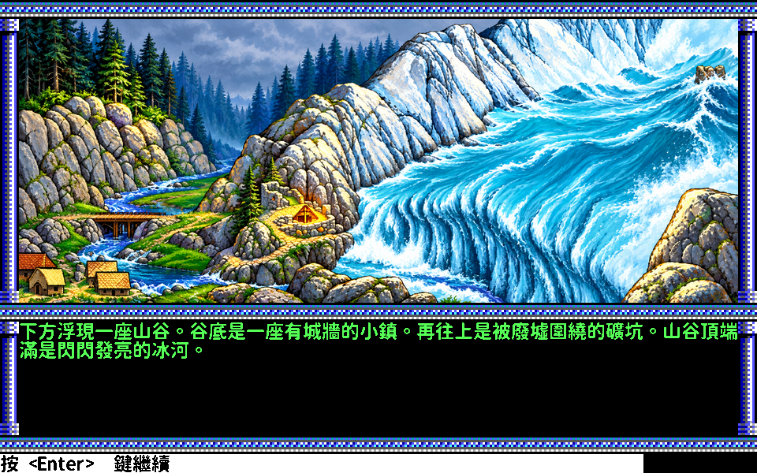 | 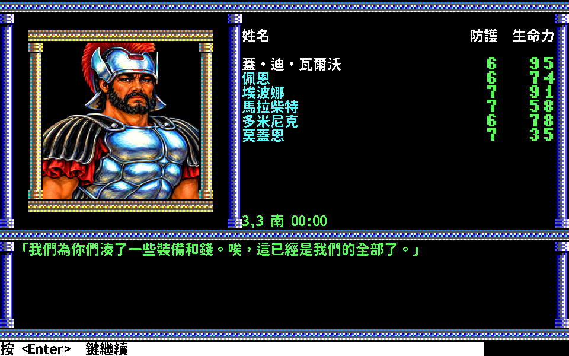 |
| 開場的山谷與旁白，HD 重繪 | 鎮長普里安頭像，HD 重繪 |
| 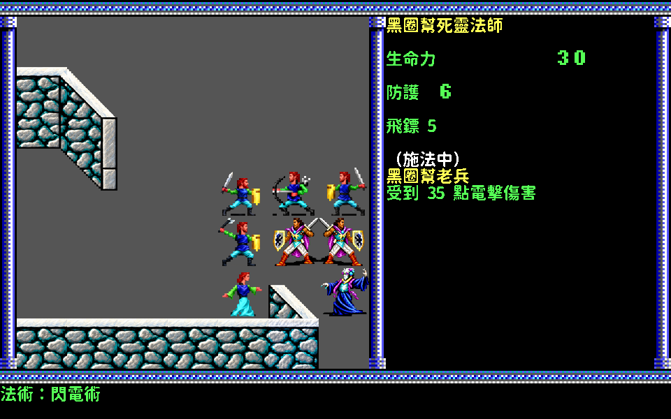 | |
| 戰鬥圖塊 HD 重繪與中文戰鬥訊息 | |

同一格的原版 3 倍（左）與 HD 牆面、地面（右）：

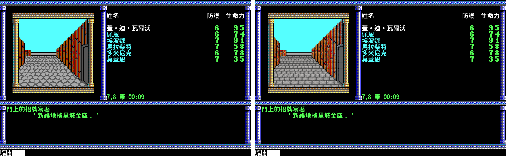

### 大圖與事件圖

劇情事件出現的大圖（BIGPIC，304×120）與事件圖（PIC，88×88）全部依原版逐張重繪。每組左為原版（3 倍最近鄰放大），右為 HD 重繪；
圖取自正式 HD 主題 `hd/theme/` 與審閱頁 `review/hd/`（[規格 010](docs/spec/010-hd-theme.md)），遊戲中只在 3 倍畫面顯示。

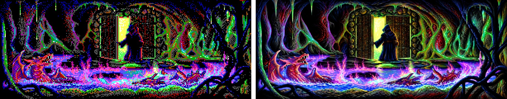

洞窟深處的門口，黑袍身影站在火光與魔物之間（BIGPIC1 區塊 112）

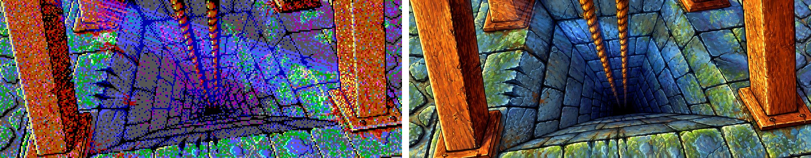

木樑撐住、往下延伸的礦坑豎井（BIGPIC1 區塊 113）

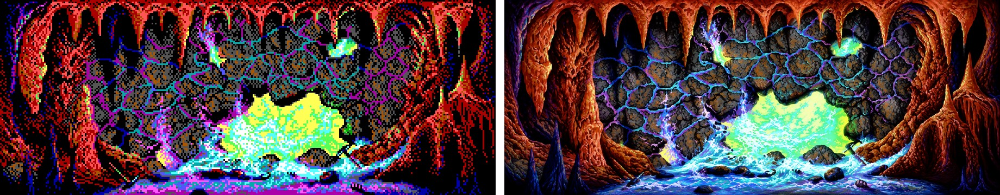

鐘乳石洞窟裡發光的岩壁破口（BIGPIC2 區塊 114）

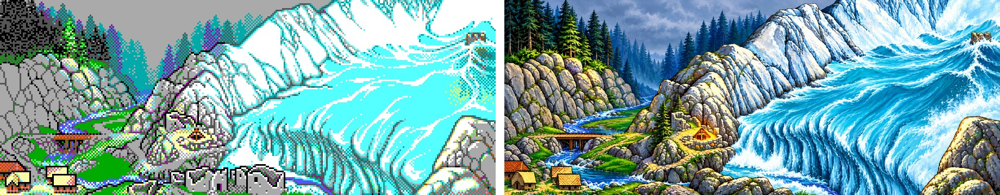

開場的山谷、小鎮與冰河（BIGPIC2 區塊 119，遊戲中的樣子見上方山谷截圖）

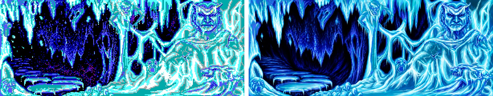

冰洞與冰裡浮現的巨大臉孔（BIGPIC3 區塊 115）

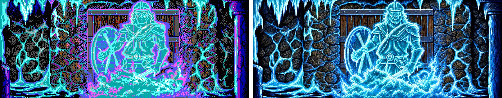

封在冰牆裡、持盾的戰士（BIGPIC3 區塊 116）

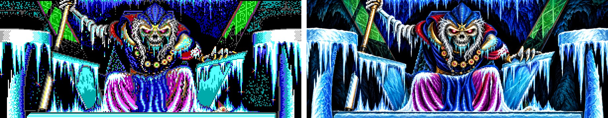

冰座上的骷髏巫妖（BIGPIC3 區塊 117）


星空中飛升的兩個靈體（BIGPIC3 區塊 118）

事件圖 38 個區塊，每個區塊取第 0 幀（動畫的其他幀也有 HD，共 77 幀）：

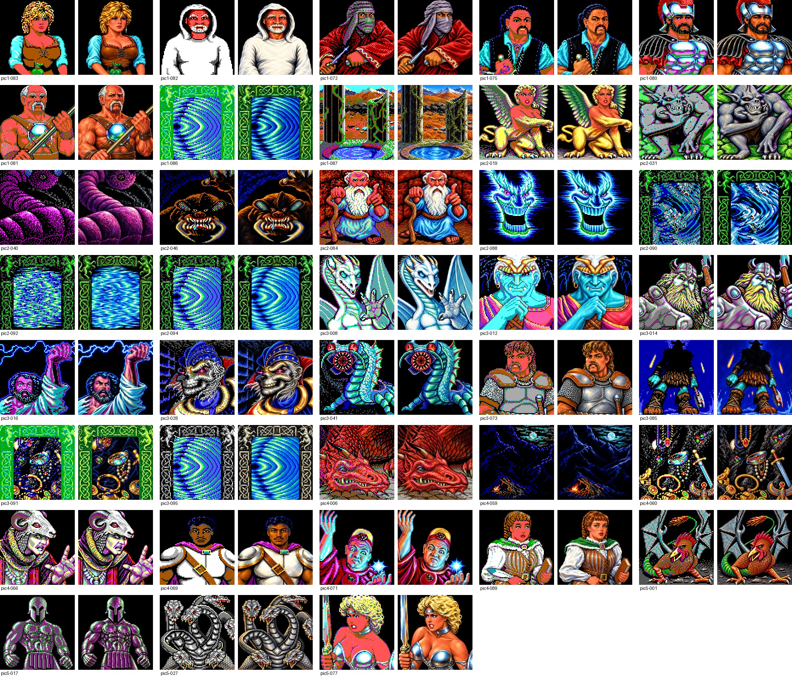

同一段鎮長對白的简中、日文、韓文、英文。日文、韓文沒有隊員名音譯表，名字顯示原文：

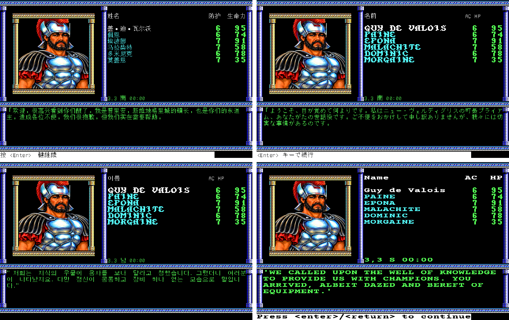

## 遊玩

### 發行包

發行包分 Linux AppImage、Windows zip 與 macOS zip，各有原版與原版加 HD 兩種，玩家自備原版：
把原版遊戲資料夾（含 `START.EXE`、`GAME.OVR`）放成程式旁邊的 `original/`，第一次啟動會複製到使用者資料目錄，存檔也寫在那裡。
程式只接受 DOS 英文版 1.30，啟動時核對兩個檔的 SHA-256。按鍵、資料目錄與已知限制見
[docs/release/讀我.txt](docs/release/讀我.txt)，打包與各平台冒煙見 [規格 012](docs/spec/012-release-packaging.md)。

Linux 與 Windows（Wine）實際執行過發行包，macOS 只檢查了包的結構。macOS 版沒有 Apple 簽章，第一次要在 Finder 按右鍵選「打開」。

### 開發環境

```sh
tools/play.sh   # Docker＋主機 X11；F2 切換 2 倍／3 倍，F12 中文／原版
```

需先依 [docs/re/001](docs/re/001-input-baseline.md) 準備原版，用 `tools/font-dev.sh` 建立字型。
原版第一次執行會詢問顯示卡與音效，程式已代為選好 EGA、AdLib 與滑鼠；原版附的預建隊伍在主選單選 LOAD SAVED GAME 載入。

## 語言

繁體中文為人工翻譯。簡體中文由繁體中文以 OpenCC 轉換。日文、韓文為機器翻譯，未經母語者校對。
英文版保留原文，以 Courier Prime 重繪，並可在遊戲內閱讀英文手札。第一次啟動依系統語言選擇，遊戲中按 F8 切換，
規格見克萊恩英豪規格 015 與本作 [docs/spec/000-index.md](docs/spec/000-index.md)。

## 已知限制

- 礦坑與孿生城堡地下城多層共用同一張地圖，攻略點還沒標示。
- 冰河裂縫與廢墟一帶的雜誌地圖沒有格線，沒有攻略點。
- 手札地圖頁由英文手札的地圖衍生，只放在本機完整版。

## 文件

| 文件 | 內容 |
|---|---|
| [CONTEXT.md](CONTEXT.md) | 目前狀態與使用者決策 |
| [docs/spec/000-index.md](docs/spec/000-index.md) | 規格索引與各規格的驗證狀態 |
| [docs/re/README.md](docs/re/README.md) | 逆向與收據紀錄 |
| [WORKLOG.md](WORKLOG.md) | 逐輪工作紀錄與勘誤 |

## 授權

本專案自有的程式與文件採 [RRSAL-1.0](LICENSE)（source-available，非商業免費、商業另洽）。
授權不涵蓋原版遊戲素材與中文說明書，使用者須自備合法取得的原版。手札譯自 SSI 英文版 Adventurer's Journal
並參照軟體世界珍藏版 056 說明書，攻略取自《軟體世界》雜誌第 21–25 期，著作權屬原權利人。
本專案與原版遊戲及說明書的權利人沒有隸屬關係。
