# HD 重繪審閱

《銀色匕首之謎》HD 第一階段（標題、大圖、肖像與場景）。左為原版（最近鄰 3 倍），右為依原版手繪重畫的 HD。
生圖由 Codex 內建 image_gen；請求、驗收與接入見 [規格 010](../../docs/spec/010-hd-theme.md)。

共 89 項，通過 89 項。數值閘門：結構分數 ≥ 0.40、色相差中位 < 30 度；另逐張目視。
HD 圖為 JPEG 預覽，正式主題是無損 PNG。

本目錄含原版圖，只放在 private repo 供審閱；repo 轉公開前必須連同歷史移除。

## 標題畫面

| 項目 | 原版 | HD |
|---|---|---|
| `title-ssi` 組圖：TITLE.DAX:1@0,0 畫面證據：已觀測 結構 0.65 色相 6.5° **通過** |  |  |
| `title-bg` 組圖：TITLE.DAX:2@0,0 畫面證據：已觀測 結構 0.67 色相 18.0° **通過** |  |  |
| `title-fr` 組圖：TITLE.DAX:2@0,0+TITLE.DAX:3@16,40 畫面證據：已觀測 結構 0.79 色相 18.4° **通過** |  |  |
| `title` 組圖：TITLE.DAX:2@0,0+TITLE.DAX:4@40,40 畫面證據：已觀測 結構 0.75 色相 18.7° **通過** |  |  |

## 大圖

| 項目 | 原版 | HD |
|---|---|---|
| `bigpic1-112` BIGPIC1.DAX 區塊 112 幀 0/1 畫面證據：未觀測 結構 0.63 色相 21.7° **通過** | 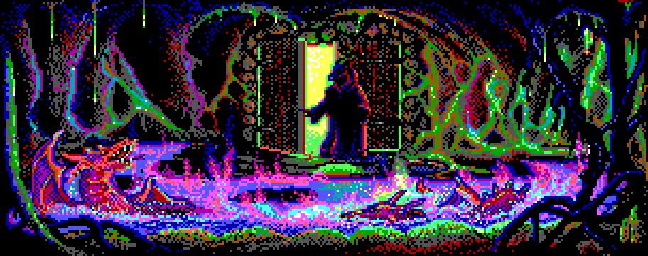 |  |
| `bigpic1-113` BIGPIC1.DAX 區塊 113 幀 0/1 畫面證據：未觀測 結構 0.42 色相 27.0° **通過** | 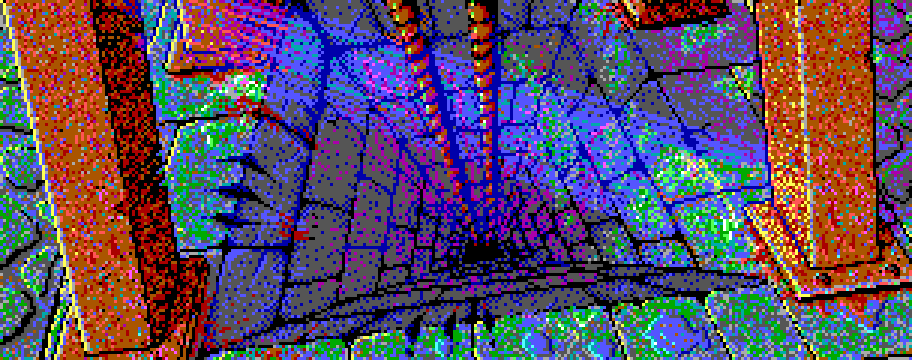 |  |
| `bigpic2-114` BIGPIC2.DAX 區塊 114 幀 0/1 畫面證據：未觀測 結構 0.48 色相 15.9° **通過** |  | 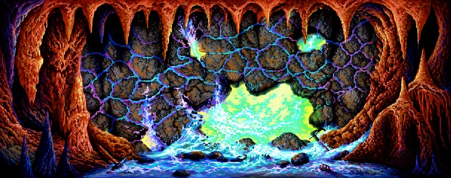 |
| `bigpic2-119` BIGPIC2.DAX 區塊 119 幀 0/1 畫面證據：未觀測 結構 0.41 色相 19.1° **通過** |  |  |
| `bigpic3-115` BIGPIC3.DAX 區塊 115 幀 0/1 畫面證據：未觀測 結構 0.52 色相 15.7° **通過** |  |  |
| `bigpic3-116` BIGPIC3.DAX 區塊 116 幀 0/1 畫面證據：未觀測 結構 0.47 色相 22.1° **通過** |  | 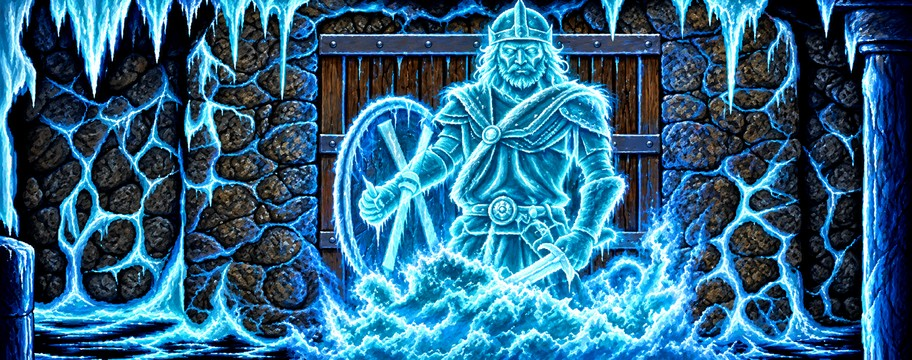 |
| `bigpic3-117` BIGPIC3.DAX 區塊 117 幀 0/1 畫面證據：未觀測 結構 0.60 色相 20.0° **通過** | 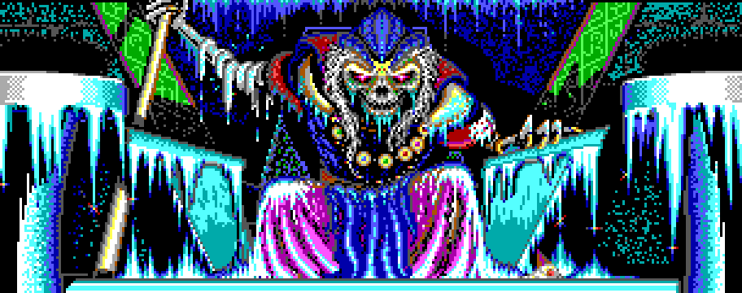 |  |
| `bigpic3-118` BIGPIC3.DAX 區塊 118 幀 0/1 畫面證據：未觀測 結構 0.57 色相 14.0° **通過** |  |  |

## 肖像與場景

| 項目 | 原版 | HD |
|---|---|---|
| `pic1-083` PIC1.DAX 區塊 83 幀 0/1 畫面證據：已觀測 結構 0.59 色相 11.4° **通過** |  |  |
| `pic1-082` PIC1.DAX 區塊 82 幀 0/1 畫面證據：已觀測 結構 0.74 色相 13.1° **通過** |  |  |
| `pic1-072` PIC1.DAX 區塊 72 幀 0/1 畫面證據：未觀測 結構 0.67 色相 2.3° **通過** |  |  |
| `pic1-075` PIC1.DAX 區塊 75 幀 0/1 畫面證據：未觀測 結構 0.61 色相 13.1° **通過** |  |  |
| `pic1-080` PIC1.DAX 區塊 80 幀 0/1 畫面證據：未觀測 結構 0.52 色相 19.6° **通過** |  |  |
| `pic1-081` PIC1.DAX 區塊 81 幀 0/1 畫面證據：未觀測 結構 0.52 色相 15.3° **通過** |  |  |
| `pic1-086@0` PIC1.DAX 區塊 86 幀 0/2 畫面證據：未觀測 結構 0.48 色相 20.8° **通過** | 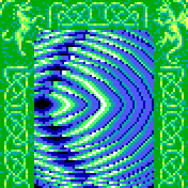 |  |
| `pic1-086@1` PIC1.DAX 區塊 86 幀 1/2 畫面證據：未觀測 結構 0.58 色相 20.7° **通過** | 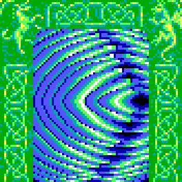 |  |
| `pic1-087@0` PIC1.DAX 區塊 87 幀 0/4 畫面證據：未觀測 結構 0.48 色相 25.6° **通過** |  |  |
| `pic1-087@1` PIC1.DAX 區塊 87 幀 1/4 畫面證據：未觀測 結構 0.48 色相 25.8° **通過** |  |  |
| `pic1-087@2` PIC1.DAX 區塊 87 幀 2/4 畫面證據：未觀測 結構 0.46 色相 25.8° **通過** |  |  |
| `pic1-087@3` PIC1.DAX 區塊 87 幀 3/4 畫面證據：未觀測 結構 0.47 色相 25.7° **通過** | 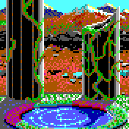 |  |
| `pic2-019` PIC2.DAX 區塊 19 幀 0/1 畫面證據：未觀測 結構 0.74 色相 13.9° **通過** |  |  |
| `pic2-031@0` PIC2.DAX 區塊 31 幀 0/4 畫面證據：未觀測 結構 0.59 色相 26.2° **通過** |  |  |
| `pic2-031@1` PIC2.DAX 區塊 31 幀 1/4 畫面證據：未觀測 結構 0.54 色相 26.4° **通過** |  |  |
| `pic2-031@2` PIC2.DAX 區塊 31 幀 2/4 畫面證據：未觀測 結構 0.55 色相 26.6° **通過** |  |  |
| `pic2-040@0` PIC2.DAX 區塊 40 幀 0/3 畫面證據：未觀測 結構 0.58 色相 16.5° **通過** |  |  |
| `pic2-040@1` PIC2.DAX 區塊 40 幀 1/3 畫面證據：未觀測 結構 0.68 色相 13.2° **通過** |  |  |
| `pic2-040@2` PIC2.DAX 區塊 40 幀 2/3 畫面證據：未觀測 結構 0.49 色相 18.5° **通過** |  |  |
| `pic2-046@0` PIC2.DAX 區塊 46 幀 0/4 畫面證據：未觀測 結構 0.63 色相 7.0° **通過** |  |  |
| `pic2-046@1` PIC2.DAX 區塊 46 幀 1/4 畫面證據：未觀測 結構 0.47 色相 8.8° **通過** |  |  |
| `pic2-046@2` PIC2.DAX 區塊 46 幀 2/4 畫面證據：未觀測 結構 0.69 色相 7.4° **通過** |  |  |
| `pic2-046@3` PIC2.DAX 區塊 46 幀 3/4 畫面證據：未觀測 結構 0.56 色相 7.8° **通過** |  |  |
| `pic2-084@0` PIC2.DAX 區塊 84 幀 0/7 畫面證據：未觀測 結構 0.66 色相 12.5° **通過** |  |  |
| `pic2-084@1` PIC2.DAX 區塊 84 幀 1/7 畫面證據：未觀測 結構 0.57 色相 12.7° **通過** |  |  |
| `pic2-084@2` PIC2.DAX 區塊 84 幀 2/7 畫面證據：未觀測 結構 0.66 色相 12.5° **通過** |  |  |
| `pic2-084@4` PIC2.DAX 區塊 84 幀 4/7 畫面證據：未觀測 結構 0.57 色相 13.0° **通過** |  |  |
| `pic2-084@5` PIC2.DAX 區塊 84 幀 5/7 畫面證據：未觀測 結構 0.49 色相 14.0° **通過** |  |  |
| `pic2-084@6` PIC2.DAX 區塊 84 幀 6/7 畫面證據：未觀測 結構 0.66 色相 12.5° **通過** |  |  |
| `pic2-088` PIC2.DAX 區塊 88 幀 0/1 畫面證據：未觀測 結構 0.79 色相 11.7° **通過** |  |  |
| `pic2-090@0` PIC2.DAX 區塊 90 幀 0/2 畫面證據：未觀測 結構 0.52 色相 10.1° **通過** |  |  |
| `pic2-090@1` PIC2.DAX 區塊 90 幀 1/2 畫面證據：未觀測 結構 0.49 色相 11.5° **通過** |  |  |
| `pic2-092@0` PIC2.DAX 區塊 92 幀 0/2 畫面證據：未觀測 結構 0.53 色相 24.8° **通過** |  |  |
| `pic2-092@1` PIC2.DAX 區塊 92 幀 1/2 畫面證據：未觀測 結構 0.46 色相 25.2° **通過** |  |  |
| `pic2-094@0` PIC2.DAX 區塊 94 幀 0/2 畫面證據：未觀測 結構 0.66 色相 18.8° **通過** | 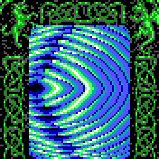 |  |
| `pic2-094@1` PIC2.DAX 區塊 94 幀 1/2 畫面證據：未觀測 結構 0.67 色相 17.9° **通過** | 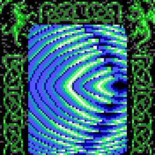 |  |
| `pic3-008@0` PIC3.DAX 區塊 8 幀 0/4 畫面證據：未觀測 結構 0.71 色相 27.7° **通過** |  |  |
| `pic3-008@1` PIC3.DAX 區塊 8 幀 1/4 畫面證據：未觀測 結構 0.49 色相 29.0° **通過** |  |  |
| `pic3-008@2` PIC3.DAX 區塊 8 幀 2/4 畫面證據：未觀測 結構 0.48 色相 28.5° **通過** |  |  |
| `pic3-008@3` PIC3.DAX 區塊 8 幀 3/4 畫面證據：未觀測 結構 0.67 色相 27.7° **通過** |  |  |
| `pic3-012` PIC3.DAX 區塊 12 幀 0/1 畫面證據：未觀測 結構 0.56 色相 11.9° **通過** |  |  |
| `pic3-014` PIC3.DAX 區塊 14 幀 0/1 畫面證據：未觀測 結構 0.72 色相 13.6° **通過** |  |  |
| `pic3-016@0` PIC3.DAX 區塊 16 幀 0/4 畫面證據：未觀測 結構 0.60 色相 21.1° **通過** |  |  |
| `pic3-016@1` PIC3.DAX 區塊 16 幀 1/4 畫面證據：未觀測 結構 0.51 色相 23.2° **通過** 備註：原版這一幀人物被閃光照成青白色；HD 保留閃電，人物維持正常膚色 |  |  |
| `pic3-016@2` PIC3.DAX 區塊 16 幀 2/4 畫面證據：未觀測 結構 0.57 色相 22.7° **通過** |  |  |
| `pic3-016@3` PIC3.DAX 區塊 16 幀 3/4 畫面證據：未觀測 結構 0.44 色相 28.9° **通過** |  |  |
| `pic3-028` PIC3.DAX 區塊 28 幀 0/1 畫面證據：未觀測 結構 0.69 色相 9.1° **通過** |  |  |
| `pic3-041@0` PIC3.DAX 區塊 41 幀 0/3 畫面證據：未觀測 結構 0.74 色相 15.9° **通過** |  |  |
| `pic3-041@1` PIC3.DAX 區塊 41 幀 1/3 畫面證據：未觀測 結構 0.42 色相 22.4° **通過** |  |  |
| `pic3-041@2` PIC3.DAX 區塊 41 幀 2/3 畫面證據：未觀測 結構 0.67 色相 15.6° **通過** |  |  |
| `pic3-073` PIC3.DAX 區塊 73 幀 0/1 畫面證據：未觀測 結構 0.46 色相 11.7° **通過** |  |  |
| `pic3-085` PIC3.DAX 區塊 85 幀 0/1 畫面證據：未觀測 結構 0.59 色相 5.3° **通過** |  |  |
| `pic3-091@0` PIC3.DAX 區塊 91 幀 0/2 畫面證據：未觀測 結構 0.57 色相 17.8° **通過** |  |  |
| `pic3-091@1` PIC3.DAX 區塊 91 幀 1/2 畫面證據：未觀測 結構 0.54 色相 17.4° **通過** | 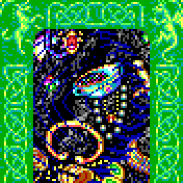 |  |
| `pic3-095@0` PIC3.DAX 區塊 95 幀 0/2 畫面證據：未觀測 結構 0.60 色相 21.2° **通過** |  |  |
| `pic3-095@1` PIC3.DAX 區塊 95 幀 1/2 畫面證據：未觀測 結構 0.67 色相 19.6° **通過** | 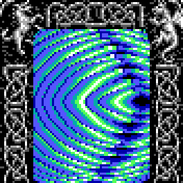 | 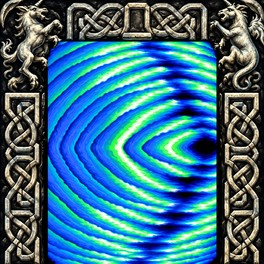 |
| `pic4-006@0` PIC4.DAX 區塊 6 幀 0/8 畫面證據：未觀測 結構 0.65 色相 4.8° **通過（沿用克萊恩英豪）** |  |  |
| `pic4-006@1` PIC4.DAX 區塊 6 幀 1/8 畫面證據：未觀測 結構 0.63 色相 4.8° **通過（沿用克萊恩英豪）** |  |  |
| `pic4-006@2` PIC4.DAX 區塊 6 幀 2/8 畫面證據：未觀測 結構 0.64 色相 4.8° **通過（沿用克萊恩英豪）** |  |  |
| `pic4-006@3` PIC4.DAX 區塊 6 幀 3/8 畫面證據：未觀測 結構 0.64 色相 4.8° **通過（沿用克萊恩英豪）** |  |  |
| `pic4-006@4` PIC4.DAX 區塊 6 幀 4/8 畫面證據：未觀測 結構 0.65 色相 4.8° **通過（沿用克萊恩英豪）** |  |  |
| `pic4-006@5` PIC4.DAX 區塊 6 幀 5/8 畫面證據：未觀測 結構 0.63 色相 4.8° **通過（沿用克萊恩英豪）** |  |  |
| `pic4-006@6` PIC4.DAX 區塊 6 幀 6/8 畫面證據：未觀測 結構 0.59 色相 4.7° **通過（沿用克萊恩英豪）** |  |  |
| `pic4-059` PIC4.DAX 區塊 59 幀 0/1 畫面證據：未觀測 結構 0.68 色相 10.7° **通過** |  | 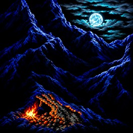 |
| `pic4-060` PIC4.DAX 區塊 60 幀 0/1 畫面證據：未觀測 結構 0.68 色相 23.0° **通過** |  |  |
| `pic4-066` PIC4.DAX 區塊 66 幀 0/1 畫面證據：未觀測 結構 0.82 色相 8.7° **通過** |  |  |
| `pic4-069` PIC4.DAX 區塊 69 幀 0/1 畫面證據：未觀測 結構 0.66 色相 4.6° **通過** |  |  |
| `pic4-071` PIC4.DAX 區塊 71 幀 0/1 畫面證據：未觀測 結構 0.54 色相 20.3° **通過** |  |  |
| `pic4-089` PIC4.DAX 區塊 89 幀 0/1 畫面證據：未觀測 結構 0.57 色相 11.7° **通過** |  |  |
| `pic5-001` PIC5.DAX 區塊 1 幀 0/1 畫面證據：未觀測 結構 0.57 色相 15.3° **通過** |  |  |
| `pic5-017@0` PIC5.DAX 區塊 17 幀 0/4 畫面證據：未觀測 結構 0.58 色相 18.8° **通過** |  |  |
| `pic5-017@1` PIC5.DAX 區塊 17 幀 1/4 畫面證據：未觀測 結構 0.55 色相 24.4° **通過** |  |  |
| `pic5-017@3` PIC5.DAX 區塊 17 幀 3/4 畫面證據：未觀測 結構 0.54 色相 21.1° **通過** |  |  |
| `pic5-027@0` PIC5.DAX 區塊 27 幀 0/3 畫面證據：未觀測 結構 0.56 色相 11.3° **通過** |  |  |
| `pic5-027@1` PIC5.DAX 區塊 27 幀 1/3 畫面證據：未觀測 結構 0.46 色相 18.4° **通過** |  |  |
| `pic5-027@2` PIC5.DAX 區塊 27 幀 2/3 畫面證據：未觀測 結構 0.45 色相 11.8° **通過** | 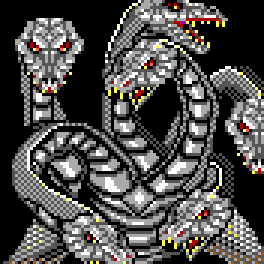 |  |
| `pic5-077` PIC5.DAX 區塊 77 幀 0/1 畫面證據：未觀測 結構 0.58 色相 17.6° **通過** |  |  |
