# HD 重繪審閱

《銀色匕首之謎》HD：第一階段（標題、大圖、肖像與場景）、第二階段（戰鬥地形、怪物、遭遇圖、效果、頭身組件）、
第三階段（3D 牆面圖塊、天空與地面）。
每組左為原版（最近鄰放大），右為依原版手繪重畫的 HD；小圖以 6 倍顯示。
生圖由 Codex 內建 image_gen；請求、驗收與接入見 [規格 010](../../docs/spec/010-hd-theme.md)。

共 1738 項，通過 1735 項。數值閘門：結構分數 ≥ 0.40、色相差中位 < 30 度；另逐張目視。
HD 圖為 JPEG 預覽，正式主題是無損 PNG。

本目錄含原版圖，只放在 private repo 供審閱；repo 轉公開前必須連同歷史移除。

## 標題畫面

| 項目 | 原版 | HD |
|---|---|---|
| `title-ssi` 組圖：TITLE.DAX:1@0,0 畫面證據：已觀測 結構 0.65 色相 6.5° **通過** |  |  |
| `title-bg` 組圖：TITLE.DAX:2@0,0 畫面證據：已觀測 結構 0.67 色相 18.0° **通過** | 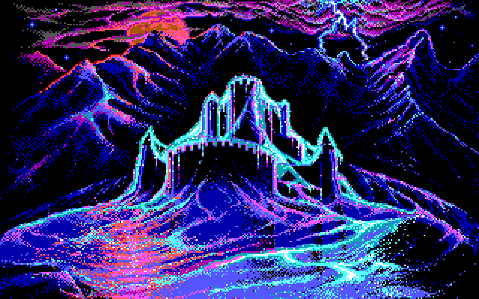 |  |
| `title-fr` 組圖：TITLE.DAX:2@0,0+TITLE.DAX:3@16,40 畫面證據：已觀測 結構 0.79 色相 18.4° **通過** |  |  |
| `title` 組圖：TITLE.DAX:2@0,0+TITLE.DAX:4@40,40 畫面證據：已觀測 結構 0.75 色相 18.7° **通過** |  |  |

## 大圖

| 項目 | 原版 | HD |
|---|---|---|
| `bigpic1-112` BIGPIC1.DAX 區塊 112 幀 0/1 畫面證據：未觀測 結構 0.63 色相 21.7° **通過** |  |  |
| `bigpic1-113` BIGPIC1.DAX 區塊 113 幀 0/1 畫面證據：未觀測 結構 0.42 色相 27.0° **通過** |  |  |
| `bigpic2-114` BIGPIC2.DAX 區塊 114 幀 0/1 畫面證據：未觀測 結構 0.48 色相 15.9° **通過** | 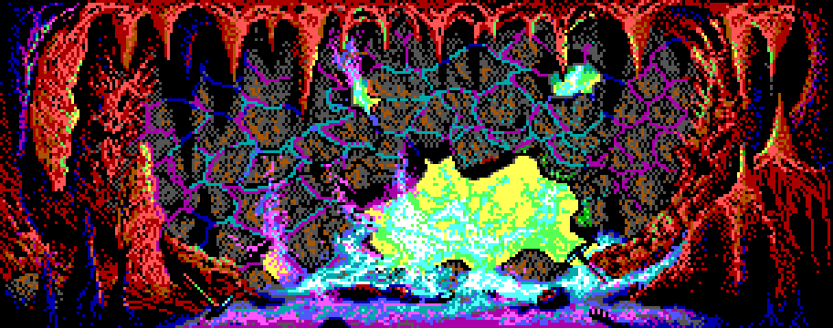 |  |
| `bigpic2-119` BIGPIC2.DAX 區塊 119 幀 0/1 畫面證據：未觀測 結構 0.41 色相 19.1° **通過** | 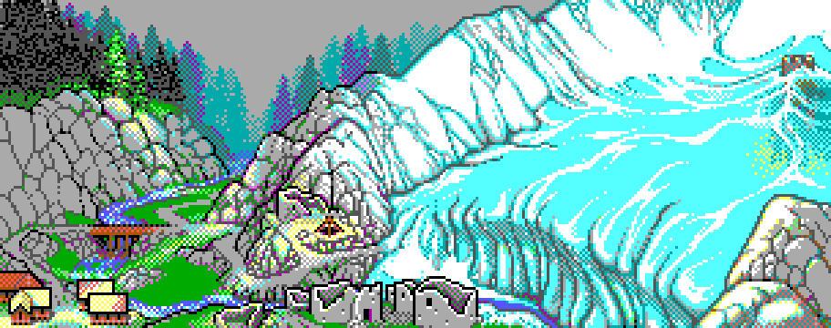 |  |
| `bigpic3-115` BIGPIC3.DAX 區塊 115 幀 0/1 畫面證據：未觀測 結構 0.52 色相 15.7° **通過** | 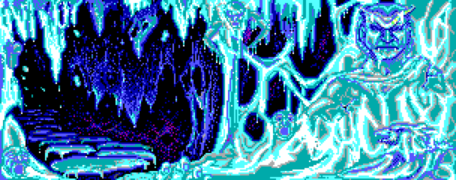 | 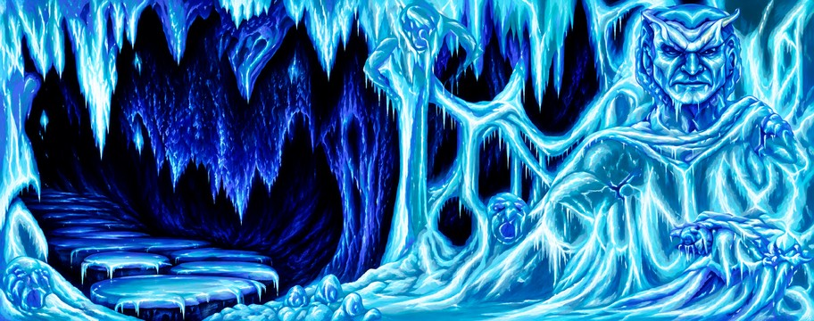 |
| `bigpic3-116` BIGPIC3.DAX 區塊 116 幀 0/1 畫面證據：未觀測 結構 0.47 色相 22.1° **通過** | 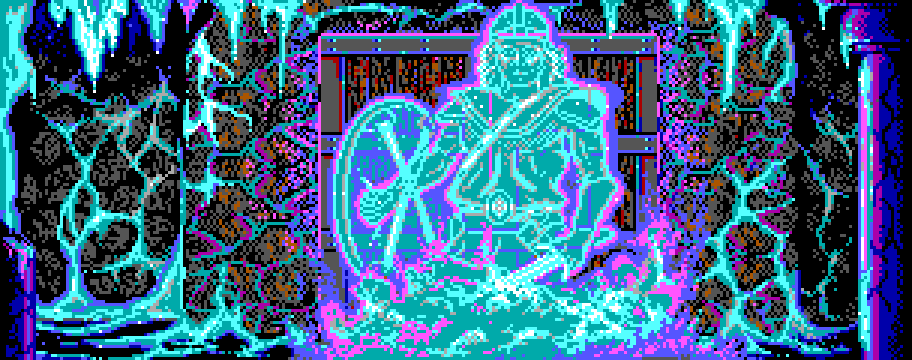 |  |
| `bigpic3-117` BIGPIC3.DAX 區塊 117 幀 0/1 畫面證據：未觀測 結構 0.60 色相 20.0° **通過** |  | 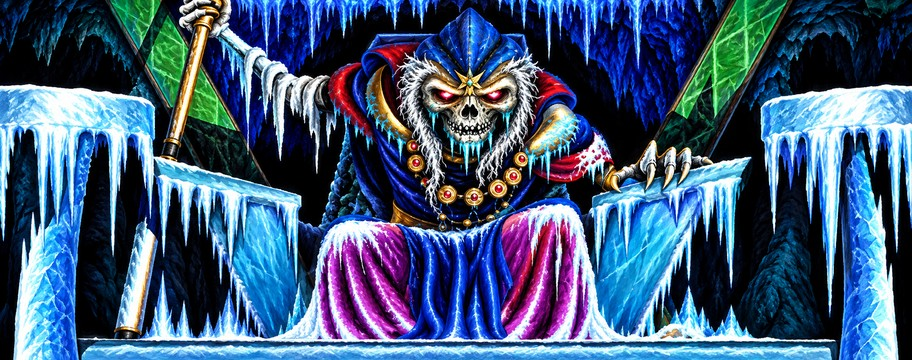 |
| `bigpic3-118` BIGPIC3.DAX 區塊 118 幀 0/1 畫面證據：未觀測 結構 0.57 色相 14.0° **通過** | 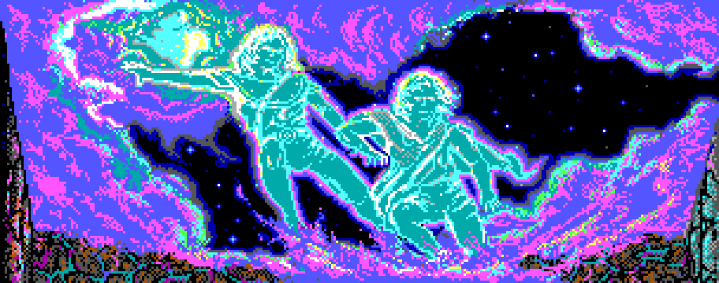 |  |

## 肖像與場景

| 項目 | 原版 | HD |
|---|---|---|
| `pic1-083` PIC1.DAX 區塊 83 幀 0/1 畫面證據：已觀測 結構 0.59 色相 11.4° **通過** | 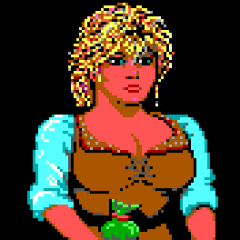 |  |
| `pic1-082` PIC1.DAX 區塊 82 幀 0/1 畫面證據：已觀測 結構 0.74 色相 13.1° **通過** |  |  |
| `pic1-072` PIC1.DAX 區塊 72 幀 0/1 畫面證據：未觀測 結構 0.67 色相 2.3° **通過** |  |  |
| `pic1-075` PIC1.DAX 區塊 75 幀 0/1 畫面證據：未觀測 結構 0.61 色相 13.1° **通過** |  |  |
| `pic1-080` PIC1.DAX 區塊 80 幀 0/1 畫面證據：未觀測 結構 0.52 色相 19.6° **通過** |  | 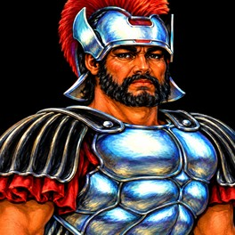 |
| `pic1-081` PIC1.DAX 區塊 81 幀 0/1 畫面證據：未觀測 結構 0.52 色相 15.3° **通過** | 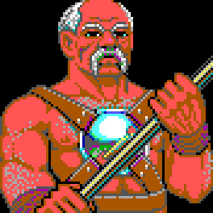 |  |
| `pic1-086@0` PIC1.DAX 區塊 86 幀 0/2 畫面證據：未觀測 結構 0.48 色相 20.8° **通過** |  |  |
| `pic1-086@1` PIC1.DAX 區塊 86 幀 1/2 畫面證據：未觀測 結構 0.58 色相 20.7° **通過** |  |  |
| `pic1-087@0` PIC1.DAX 區塊 87 幀 0/4 畫面證據：未觀測 結構 0.48 色相 25.6° **通過** |  |  |
| `pic1-087@1` PIC1.DAX 區塊 87 幀 1/4 畫面證據：未觀測 結構 0.48 色相 25.8° **通過** | 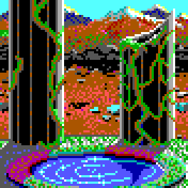 |  |
| `pic1-087@2` PIC1.DAX 區塊 87 幀 2/4 畫面證據：未觀測 結構 0.46 色相 25.8° **通過** | 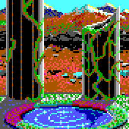 |  |
| `pic1-087@3` PIC1.DAX 區塊 87 幀 3/4 畫面證據：未觀測 結構 0.47 色相 25.7° **通過** |  | 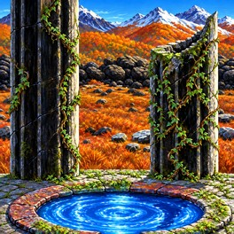 |
| `pic2-019` PIC2.DAX 區塊 19 幀 0/1 畫面證據：未觀測 結構 0.74 色相 13.9° **通過** |  |  |
| `pic2-031@0` PIC2.DAX 區塊 31 幀 0/4 畫面證據：未觀測 結構 0.59 色相 26.2° **通過** |  |  |
| `pic2-031@1` PIC2.DAX 區塊 31 幀 1/4 畫面證據：未觀測 結構 0.54 色相 26.4° **通過** |  |  |
| `pic2-031@2` PIC2.DAX 區塊 31 幀 2/4 畫面證據：未觀測 結構 0.55 色相 26.6° **通過** |  |  |
| `pic2-040@0` PIC2.DAX 區塊 40 幀 0/3 畫面證據：未觀測 結構 0.58 色相 16.5° **通過** |  | 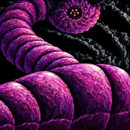 |
| `pic2-040@1` PIC2.DAX 區塊 40 幀 1/3 畫面證據：未觀測 結構 0.68 色相 13.2° **通過** | 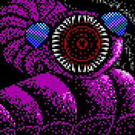 |  |
| `pic2-040@2` PIC2.DAX 區塊 40 幀 2/3 畫面證據：未觀測 結構 0.49 色相 18.5° **通過** |  |  |
| `pic2-046@0` PIC2.DAX 區塊 46 幀 0/4 畫面證據：未觀測 結構 0.63 色相 7.0° **通過** |  |  |
| `pic2-046@1` PIC2.DAX 區塊 46 幀 1/4 畫面證據：未觀測 結構 0.47 色相 8.8° **通過** |  |  |
| `pic2-046@2` PIC2.DAX 區塊 46 幀 2/4 畫面證據：未觀測 結構 0.69 色相 7.4° **通過** |  |  |
| `pic2-046@3` PIC2.DAX 區塊 46 幀 3/4 畫面證據：未觀測 結構 0.56 色相 7.8° **通過** | 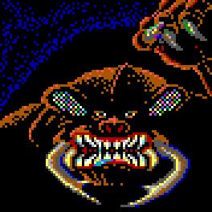 |  |
| `pic2-084@0` PIC2.DAX 區塊 84 幀 0/7 畫面證據：未觀測 結構 0.66 色相 12.5° **通過** |  |  |
| `pic2-084@1` PIC2.DAX 區塊 84 幀 1/7 畫面證據：未觀測 結構 0.57 色相 12.7° **通過** |  |  |
| `pic2-084@2` PIC2.DAX 區塊 84 幀 2/7 畫面證據：未觀測 結構 0.66 色相 12.5° **通過** |  |  |
| `pic2-084@4` PIC2.DAX 區塊 84 幀 4/7 畫面證據：未觀測 結構 0.57 色相 13.0° **通過** |  |  |
| `pic2-084@5` PIC2.DAX 區塊 84 幀 5/7 畫面證據：未觀測 結構 0.49 色相 14.0° **通過** |  |  |
| `pic2-084@6` PIC2.DAX 區塊 84 幀 6/7 畫面證據：未觀測 結構 0.66 色相 12.5° **通過** |  |  |
| `pic2-088` PIC2.DAX 區塊 88 幀 0/1 畫面證據：未觀測 結構 0.79 色相 11.7° **通過** |  |  |
| `pic2-090@0` PIC2.DAX 區塊 90 幀 0/2 畫面證據：未觀測 結構 0.52 色相 10.1° **通過** |  | 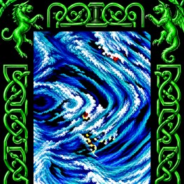 |
| `pic2-090@1` PIC2.DAX 區塊 90 幀 1/2 畫面證據：未觀測 結構 0.49 色相 11.5° **通過** | 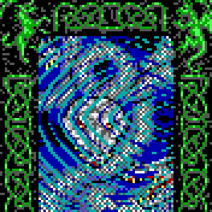 |  |
| `pic2-092@0` PIC2.DAX 區塊 92 幀 0/2 畫面證據：未觀測 結構 0.53 色相 24.8° **通過** |  | 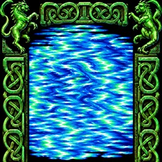 |
| `pic2-092@1` PIC2.DAX 區塊 92 幀 1/2 畫面證據：未觀測 結構 0.46 色相 25.2° **通過** | 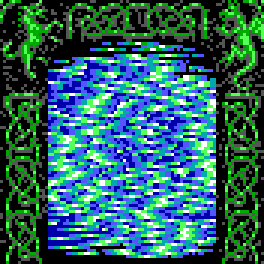 | 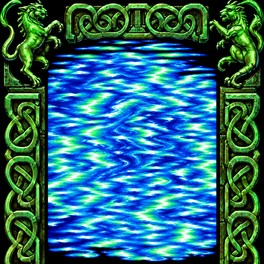 |
| `pic2-094@0` PIC2.DAX 區塊 94 幀 0/2 畫面證據：未觀測 結構 0.66 色相 18.8° **通過** |  |  |
| `pic2-094@1` PIC2.DAX 區塊 94 幀 1/2 畫面證據：未觀測 結構 0.67 色相 17.9° **通過** |  | 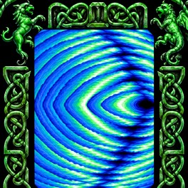 |
| `pic3-008@0` PIC3.DAX 區塊 8 幀 0/4 畫面證據：未觀測 結構 0.71 色相 27.7° **通過** |  |  |
| `pic3-008@1` PIC3.DAX 區塊 8 幀 1/4 畫面證據：未觀測 結構 0.49 色相 29.0° **通過** |  |  |
| `pic3-008@2` PIC3.DAX 區塊 8 幀 2/4 畫面證據：未觀測 結構 0.48 色相 28.5° **通過** |  |  |
| `pic3-008@3` PIC3.DAX 區塊 8 幀 3/4 畫面證據：未觀測 結構 0.67 色相 27.7° **通過** |  |  |
| `pic3-012` PIC3.DAX 區塊 12 幀 0/1 畫面證據：未觀測 結構 0.56 色相 11.9° **通過** |  |  |
| `pic3-014` PIC3.DAX 區塊 14 幀 0/1 畫面證據：未觀測 結構 0.72 色相 13.6° **通過** | 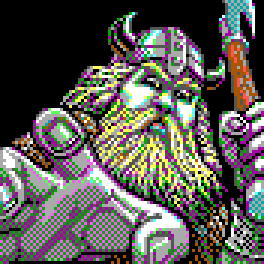 |  |
| `pic3-016@0` PIC3.DAX 區塊 16 幀 0/4 畫面證據：未觀測 結構 0.60 色相 21.1° **通過** |  |  |
| `pic3-016@1` PIC3.DAX 區塊 16 幀 1/4 畫面證據：未觀測 結構 0.51 色相 23.2° **通過** 備註：原版這一幀人物被閃光照成青白色；HD 保留閃電，人物維持正常膚色 |  |  |
| `pic3-016@2` PIC3.DAX 區塊 16 幀 2/4 畫面證據：未觀測 結構 0.57 色相 22.7° **通過** |  |  |
| `pic3-016@3` PIC3.DAX 區塊 16 幀 3/4 畫面證據：未觀測 結構 0.44 色相 28.9° **通過** |  |  |
| `pic3-028` PIC3.DAX 區塊 28 幀 0/1 畫面證據：未觀測 結構 0.69 色相 9.1° **通過** |  |  |
| `pic3-041@0` PIC3.DAX 區塊 41 幀 0/3 畫面證據：未觀測 結構 0.74 色相 15.9° **通過** |  | 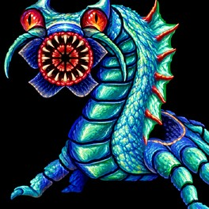 |
| `pic3-041@1` PIC3.DAX 區塊 41 幀 1/3 畫面證據：未觀測 結構 0.42 色相 22.4° **通過** | 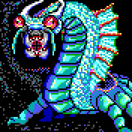 |  |
| `pic3-041@2` PIC3.DAX 區塊 41 幀 2/3 畫面證據：未觀測 結構 0.67 色相 15.6° **通過** |  |  |
| `pic3-073` PIC3.DAX 區塊 73 幀 0/1 畫面證據：未觀測 結構 0.46 色相 11.7° **通過** |  |  |
| `pic3-085` PIC3.DAX 區塊 85 幀 0/1 畫面證據：未觀測 結構 0.59 色相 5.3° **通過** | 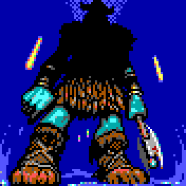 |  |
| `pic3-091@0` PIC3.DAX 區塊 91 幀 0/2 畫面證據：未觀測 結構 0.57 色相 17.8° **通過** | 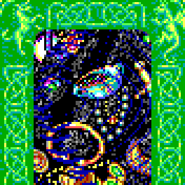 | 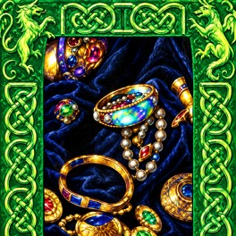 |
| `pic3-091@1` PIC3.DAX 區塊 91 幀 1/2 畫面證據：未觀測 結構 0.54 色相 17.4° **通過** |  |  |
| `pic3-095@0` PIC3.DAX 區塊 95 幀 0/2 畫面證據：未觀測 結構 0.60 色相 21.2° **通過** | 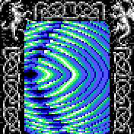 | 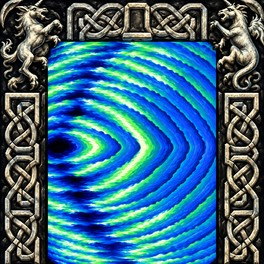 |
| `pic3-095@1` PIC3.DAX 區塊 95 幀 1/2 畫面證據：未觀測 結構 0.67 色相 19.6° **通過** |  |  |
| `pic4-006@0` PIC4.DAX 區塊 6 幀 0/8 畫面證據：未觀測 結構 0.65 色相 4.8° **通過（沿用克萊恩英豪）** |  | 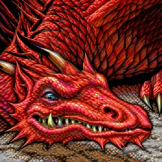 |
| `pic4-006@1` PIC4.DAX 區塊 6 幀 1/8 畫面證據：未觀測 結構 0.63 色相 4.8° **通過（沿用克萊恩英豪）** |  |  |
| `pic4-006@2` PIC4.DAX 區塊 6 幀 2/8 畫面證據：未觀測 結構 0.64 色相 4.8° **通過（沿用克萊恩英豪）** | 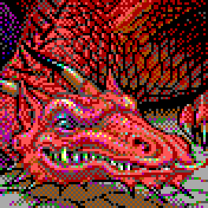 |  |
| `pic4-006@3` PIC4.DAX 區塊 6 幀 3/8 畫面證據：未觀測 結構 0.64 色相 4.8° **通過（沿用克萊恩英豪）** | 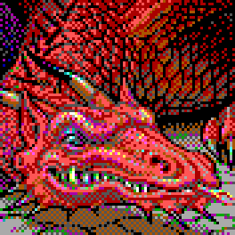 |  |
| `pic4-006@4` PIC4.DAX 區塊 6 幀 4/8 畫面證據：未觀測 結構 0.65 色相 4.8° **通過（沿用克萊恩英豪）** |  | 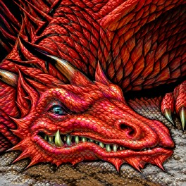 |
| `pic4-006@5` PIC4.DAX 區塊 6 幀 5/8 畫面證據：未觀測 結構 0.63 色相 4.8° **通過（沿用克萊恩英豪）** |  | 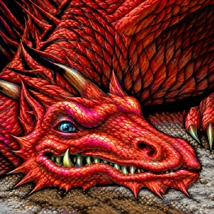 |
| `pic4-006@6` PIC4.DAX 區塊 6 幀 6/8 畫面證據：未觀測 結構 0.59 色相 4.7° **通過（沿用克萊恩英豪）** | 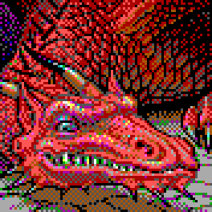 |  |
| `pic4-059` PIC4.DAX 區塊 59 幀 0/1 畫面證據：未觀測 結構 0.68 色相 10.7° **通過** | 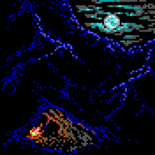 |  |
| `pic4-060` PIC4.DAX 區塊 60 幀 0/1 畫面證據：未觀測 結構 0.68 色相 23.0° **通過** |  |  |
| `pic4-066` PIC4.DAX 區塊 66 幀 0/1 畫面證據：未觀測 結構 0.82 色相 8.7° **通過** |  |  |
| `pic4-069` PIC4.DAX 區塊 69 幀 0/1 畫面證據：未觀測 結構 0.66 色相 4.6° **通過** | 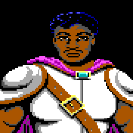 |  |
| `pic4-071` PIC4.DAX 區塊 71 幀 0/1 畫面證據：未觀測 結構 0.54 色相 20.3° **通過** |  |  |
| `pic4-089` PIC4.DAX 區塊 89 幀 0/1 畫面證據：未觀測 結構 0.57 色相 11.7° **通過** | 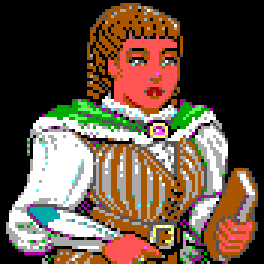 |  |
| `pic5-001` PIC5.DAX 區塊 1 幀 0/1 畫面證據：未觀測 結構 0.57 色相 15.3° **通過** |  |  |
| `pic5-017@0` PIC5.DAX 區塊 17 幀 0/4 畫面證據：未觀測 結構 0.58 色相 18.8° **通過** |  |  |
| `pic5-017@1` PIC5.DAX 區塊 17 幀 1/4 畫面證據：未觀測 結構 0.55 色相 24.4° **通過** | 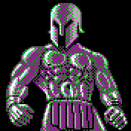 |  |
| `pic5-017@3` PIC5.DAX 區塊 17 幀 3/4 畫面證據：未觀測 結構 0.54 色相 21.1° **通過** | 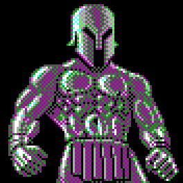 |  |
| `pic5-027@0` PIC5.DAX 區塊 27 幀 0/3 畫面證據：未觀測 結構 0.56 色相 11.3° **通過** |  |  |
| `pic5-027@1` PIC5.DAX 區塊 27 幀 1/3 畫面證據：未觀測 結構 0.46 色相 18.4° **通過** |  |  |
| `pic5-027@2` PIC5.DAX 區塊 27 幀 2/3 畫面證據：未觀測 結構 0.45 色相 11.8° **通過** |  |  |
| `pic5-077` PIC5.DAX 區塊 77 幀 0/1 畫面證據：未觀測 結構 0.58 色相 17.6° **通過** |  |  |

## 戰鬥地形

30 項。

| 項目 | 原版 | HD | 項目 | 原版 | HD | 項目 | 原版 | HD |
|---|---|---|---|---|---|---|---|---|
| `dungcom-001-00-00` 結構 0.89、色相 4° **通過** |  |  | `dungcom-001-00-01` 結構 0.65、色相 3° **通過** | 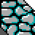 | 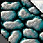 | `dungcom-001-00-02` 結構 0.88、色相 3° **通過** |  | 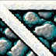 |
| `dungcom-001-00-03` 結構 0.72、色相 3° **通過** | 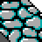 |  | `dungcom-001-00-04` 結構 0.79、色相 4° **通過** |  | 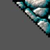 | `dungcom-001-00-05` 結構 0.76、色相 4° **通過** |  | 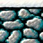 |
| `dungcom-001-00-06` 結構 0.88、色相 3° **通過** |  |  | `dungcom-001-00-07` 結構 0.66、色相 4° **通過** |  | 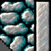 | `dungcom-001-00-08` 結構 0.88、色相 3° **通過** |  | 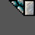 |
| `dungcom-001-00-09` 結構 0.79、色相 4° **通過** |  |  | `dungcom-001-00-10` 結構 0.68、色相 3° **通過** |  |  | `dungcom-001-00-11` 結構 0.69、色相 3° **通過** |  |  |
| `dungcom-001-00-12` 結構 0.84、色相 4° **通過** |  |  | `dungcom-001-00-13` 結構 0.92、色相 4° **通過** |  |  | `dungcom-001-00-14` 結構 0.66、色相 4° **通過** |  |  |
| `dungcom-001-00-15` 結構 0.68、色相 4° **通過** |  |  | `dungcom-001-00-16` 結構 0.82、色相 9° **通過** |  |  | `dungcom-001-00-17` 結構 0.88、色相 10° **通過** |  |  |
| `dungcom-001-00-18` 結構 0.89、色相 10° **通過** |  |  | `dungcom-001-00-19` 結構 0.82、色相 10° **通過** |  |  | `dungcom-001-00-20` 結構 0.78、色相 9° **通過** |  |  |
| `dungcom-001-00-21` 結構 0.84、色相 9° **通過** |  |  | `dungcom-001-00-22` 結構 0.00、色相 0° **通過（沿用克萊恩英豪）** |  |  | `dungcom-001-00-23` 結構 0.79、色相 9° **通過** |  |  |
| `dungcom-001-00-24` 結構 0.79、色相 9° **通過** |  |  | `dungcom-001-00-25` 結構 0.96、色相 3° **通過** |  |  | `dungcom-001-00-26` 結構 0.69、色相 12° **通過** |  |  |
| `dungcom-001-00-27` 結構 0.87、色相 7° **通過** |  |  | `dungcom-001-00-28` 結構 0.72、色相 1° **通過** |  |  | `dungcom-001-00-29` 結構 0.89、色相 6° **通過** |  |  |

## 戰鬥怪物與人物

104 項。

| 項目 | 原版 | HD | 項目 | 原版 | HD | 項目 | 原版 | HD |
|---|---|---|---|---|---|---|---|---|
| `cpic1-000-00-00` 結構 0.74、色相 9° **通過** |  |  | `cpic1-001-00-00` 結構 0.72、色相 9° **通過** |  |  | `cpic1-002-00-00` 結構 0.65、色相 4° **通過** |  |  |
| `cpic1-003-00-00` 結構 0.78、色相 11° **通過** |  |  | `cpic1-004-00-00` 結構 0.60、色相 4° **通過** |  |  | `cpic1-005-00-00` 結構 0.59、色相 3° **通過（沿用克萊恩英豪）** |  |  |
| `cpic1-006-00-00` 結構 0.72、色相 6° **通過（沿用克萊恩英豪）** |  |  | `cpic1-007-00-00` 結構 0.57、色相 3° **通過（沿用克萊恩英豪）** |  |  | `cpic1-008-00-00` 結構 0.76、色相 7° **通過** |  |  |
| `cpic1-009-00-00` 結構 0.81、色相 4° **通過** |  |  | `cpic1-010-00-00` 結構 0.67、色相 13° **通過** |  |  | `cpic1-011-00-00` 結構 0.84、色相 8° **通過** |  |  |
| `cpic1-012-00-00` 結構 0.68、色相 20° **通過** |  |  | `cpic1-013-00-00` 結構 0.65、色相 6° **通過** |  |  | `cpic1-014-00-00` 結構 0.76、色相 13° **通過** |  |  |
| `cpic1-015-00-00` 結構 0.62、色相 12° **通過** |  |  | `cpic1-016-00-00` 結構 0.74、色相 22° **通過** |  |  | `cpic1-017-00-00` 結構 0.83、色相 14° **通過** |  |  |
| `cpic1-018-00-00` 結構 0.63、色相 10° **通過** |  |  | `cpic1-019-00-00` 結構 0.71、色相 15° **通過** |  |  | `cpic1-020-00-00` 結構 0.67、色相 6° **通過** |  |  |
| `cpic1-021-00-00` 結構 0.73、色相 13° **通過** |  |  | `cpic1-027-00-00` 結構 0.70、色相 18° **通過** |  |  | `cpic1-028-00-00` 結構 0.75、色相 8° **通過** |  |  |
| `cpic1-029-00-00` 結構 0.66、色相 6° **通過** |  |  | `cpic1-030-00-00` 結構 0.72、色相 4° **通過** |  |  | `cpic1-031-00-00` 結構 0.70、色相 3° **通過** |  |  |
| `cpic1-032-00-00` 結構 0.75、色相 20° **通過** |  |  | `cpic1-033-00-00` 結構 0.76、色相 4° **通過** |  |  | `cpic1-034-00-00` 結構 0.86、色相 4° **通過（沿用克萊恩英豪）** |  |  |
| `cpic1-035-00-00` 結構 0.65、色相 15° **通過** |  |  | `cpic1-036-00-00` 結構 0.82、色相 2° **通過（沿用克萊恩英豪）** |  |  | `cpic1-037-00-00` 結構 0.74、色相 7° **通過** |  |  |
| `cpic1-038-00-00` 結構 0.72、色相 15° **通過** |  |  | `cpic1-039-00-00` 結構 0.72、色相 6° **通過** |  |  | `cpic1-040-00-00` 結構 0.79、色相 10° **通過** |  |  |
| `cpic1-041-00-00` 結構 0.74、色相 15° **通過** |  |  | `cpic1-042-00-00` 結構 0.67、色相 4° **通過** |  |  | `cpic1-043-00-00` 結構 0.73、色相 6° **通過** |  |  |
| `cpic1-045-00-00` 結構 0.60、色相 4° **通過（沿用克萊恩英豪）** |  |  | `cpic1-046-00-00` 結構 0.78、色相 9° **通過** |  |  | `cpic1-047-00-00` 結構 0.78、色相 4° **通過** |  |  |
| `cpic1-048-00-00` 結構 0.74、色相 15° **通過** |  |  | `cpic1-049-00-00` 結構 0.69、色相 12° **通過** |  |  | `cpic1-066-00-00` 結構 0.80、色相 7° **通過** |  |  |
| `cpic1-069-00-00` 結構 0.78、色相 5° **通過** |  |  | `cpic1-071-00-00` 結構 0.75、色相 4° **通過** |  |  | `cpic1-072-00-00` 結構 0.78、色相 4° **通過** |  |  |
| `cpic1-073-00-00` 結構 0.70、色相 9° **通過** |  |  | `cpic1-075-00-00` 結構 0.80、色相 5° **通過** |  |  | `cpic1-076-00-00` 結構 0.75、色相 14° **通過** |  |  |
| `cpic1-077-00-00` 結構 0.60、色相 16° **通過** |  |  | `cpic1-128-00-00` 結構 0.67、色相 9° **通過** |  |  | `cpic1-129-00-00` 結構 0.73、色相 9° **通過** |  |  |
| `cpic1-130-00-00` 結構 0.71、色相 4° **通過** |  |  | `cpic1-131-00-00` 結構 0.79、色相 9° **通過** |  |  | `cpic1-132-00-00` 結構 0.55、色相 2° **通過** |  |  |
| `cpic1-133-00-00` 結構 0.63、色相 2° **通過（沿用克萊恩英豪）** |  |  | `cpic1-134-00-00` 結構 0.79、色相 7° **通過（沿用克萊恩英豪）** |  |  | `cpic1-135-00-00` 結構 0.73、色相 3° **通過（沿用克萊恩英豪）** |  |  |
| `cpic1-136-00-00` 結構 0.77、色相 6° **通過** |  |  | `cpic1-137-00-00` 結構 0.78、色相 3° **通過** |  |  | `cpic1-138-00-00` 結構 0.67、色相 14° **通過** |  |  |
| `cpic1-139-00-00` 結構 0.80、色相 8° **通過** |  |  | `cpic1-140-00-00` 結構 0.57、色相 19° **通過** |  |  | `cpic1-141-00-00` 結構 0.71、色相 5° **通過** |  |  |
| `cpic1-142-00-00` 結構 0.77、色相 14° **通過** |  |  | `cpic1-143-00-00` 結構 0.63、色相 10° **通過** |  |  | `cpic1-144-00-00` 結構 0.67、色相 19° **通過** |  |  |
| `cpic1-145-00-00` 結構 0.80、色相 13° **通過** |  |  | `cpic1-146-00-00` 結構 0.75、色相 8° **通過** |  |  | `cpic1-147-00-00` 結構 0.77、色相 10° **通過** |  |  |
| `cpic1-148-00-00` 結構 0.54、色相 8° **通過** |  |  | `cpic1-149-00-00` 結構 0.72、色相 13° **通過** |  |  | `cpic1-155-00-00` 結構 0.70、色相 18° **通過** |  |  |
| `cpic1-156-00-00` 結構 0.68、色相 9° **通過** |  |  | `cpic1-157-00-00` 結構 0.71、色相 5° **通過** |  |  | `cpic1-158-00-00` 結構 0.73、色相 3° **通過** |  |  |
| `cpic1-159-00-00` 結構 0.76、色相 7° **通過** |  |  | `cpic1-160-00-00` 結構 0.74、色相 23° **通過** |  |  | `cpic1-161-00-00` 結構 0.76、色相 5° **通過** |  |  |
| `cpic1-162-00-00` 結構 0.75、色相 5° **通過（沿用克萊恩英豪）** |  |  | `cpic1-163-00-00` 結構 0.67、色相 10° **通過** |  |  | `cpic1-164-00-00` 結構 0.87、色相 2° **通過（沿用克萊恩英豪）** |  |  |
| `cpic1-165-00-00` 結構 0.71、色相 9° **通過** |  |  | `cpic1-166-00-00` 結構 0.64、色相 15° **通過** |  |  | `cpic1-167-00-00` 結構 0.66、色相 4° **通過** |  |  |
| `cpic1-168-00-00` 結構 0.71、色相 10° **通過** |  |  | `cpic1-169-00-00` 結構 0.69、色相 15° **通過** |  |  | `cpic1-170-00-00` 結構 0.60、色相 7° **通過** |  |  |
| `cpic1-171-00-00` 結構 0.70、色相 11° **通過** |  |  | `cpic1-173-00-00` 結構 0.55、色相 4° **通過（沿用克萊恩英豪）** |  |  | `cpic1-174-00-00` 結構 0.76、色相 10° **通過** |  |  |
| `cpic1-175-00-00` 結構 0.87、色相 4° **通過** |  |  | `cpic1-176-00-00` 結構 0.68、色相 16° **通過** |  |  | `cpic1-177-00-00` 結構 0.59、色相 12° **通過** |  |  |
| `cpic1-194-00-00` 結構 0.74、色相 11° **通過** |  |  | `cpic1-197-00-00` 結構 0.73、色相 5° **通過** |  |  | `cpic1-199-00-00` 結構 0.75、色相 4° **通過** |  |  |
| `cpic1-200-00-00` 結構 0.71、色相 6° **通過** |  |  | `cpic1-201-00-00` 結構 0.49、色相 10° **通過** |  |  | `cpic1-203-00-00` 結構 0.51、色相 4° **通過** |  |  |
| `cpic1-204-00-00` 結構 0.61、色相 7° **通過** |  |  | `cpic1-205-00-00` 結構 0.62、色相 12° **通過** |  |  |  | |  |

## 3D 遭遇圖

83 項。

| 項目 | 原版 | HD | 項目 | 原版 | HD | 項目 | 原版 | HD |
|---|---|---|---|---|---|---|---|---|
| `sprit1-001-00-00` 結構 0.00、色相 0° **維持原版** 前景低於呈現器下限（至少 16 點、3 色），不收入主題，維持原版 |  |  | `sprit1-001-01-00` 結構 0.65、色相 13° **通過** |  |  | `sprit1-001-02-00` 結構 0.88、色相 11° **通過** |  |  |
| `sprit1-003-00-00` 結構 0.61、色相 25° **通過** |  |  | `sprit1-003-01-00` 結構 0.77、色相 21° **通過** |  |  | `sprit1-003-02-00` 結構 1.00、色相 17° **通過** |  |  |
| `sprit1-006-01-00` 結構 0.89、色相 3° **通過** |  |  | `sprit1-006-02-00` 結構 0.55、色相 5° **通過** |  |  | `sprit1-008-01-00` 結構 0.54、色相 14° **通過** |  |  |
| `sprit1-008-02-00` 結構 0.66、色相 14° **通過** |  |  | `sprit1-009-00-00` 結構 0.52、色相 15° **通過** |  |  | `sprit1-009-01-00` 結構 0.69、色相 19° **通過** |  |  |
| `sprit1-009-02-00` 結構 0.89、色相 21° **通過** |  |  | `sprit1-012-01-00` 結構 0.50、色相 23° **通過** |  |  | `sprit1-012-02-00` 結構 0.62、色相 26° **通過** |  |  |
| `sprit1-013-00-00` 結構 0.60、色相 27° **通過** |  |  | `sprit1-013-01-00` 結構 0.56、色相 27° **通過** |  |  | `sprit1-013-02-00` 結構 0.71、色相 28° **通過** |  |  |
| `sprit1-014-01-00` 結構 0.62、色相 20° **通過** |  |  | `sprit1-014-02-00` 結構 0.71、色相 19° **通過** |  |  | `sprit1-016-01-00` 結構 0.52、色相 28° **通過** |  |  |
| `sprit1-016-02-00` 結構 0.61、色相 30° **通過** |  |  | `sprit1-017-01-00` 結構 0.60、色相 28° **通過** |  |  | `sprit1-017-02-00` 結構 0.66、色相 30° **通過** |  |  |
| `sprit1-018-00-00` 結構 0.46、色相 15° **通過** |  |  | `sprit1-018-01-00` 結構 0.50、色相 12° **通過** |  |  | `sprit1-018-02-00` 結構 0.59、色相 9° **通過** |  |  |
| `sprit1-019-01-00` 結構 0.70、色相 18° **通過** |  |  | `sprit1-019-02-00` 結構 0.84、色相 16° **通過** |  |  | `sprit1-020-00-00` 結構 0.60、色相 5° **通過** |  |  |
| `sprit1-020-01-00` 結構 0.68、色相 3° **通過** |  |  | `sprit1-020-02-00` 結構 1.00、色相 3° **通過** |  |  | `sprit1-021-00-00` 結構 0.53、色相 28° **通過** |  |  |
| `sprit1-021-01-00` 結構 0.68、色相 21° **通過** |  |  | `sprit1-021-02-00` 結構 0.68、色相 14° **通過** |  |  | `sprit1-027-01-00` 結構 0.59、色相 25° **通過** |  |  |
| `sprit1-027-02-00` 結構 0.78、色相 24° **通過** |  |  | `sprit1-028-00-00` 結構 0.63、色相 19° **通過** |  |  | `sprit1-028-02-00` 結構 0.91、色相 14° **通過** |  |  |
| `sprit1-030-00-00` 結構 0.63、色相 12° **通過** |  |  | `sprit1-030-01-00` 結構 0.61、色相 9° **通過** |  |  | `sprit1-030-02-00` 結構 0.70、色相 10° **通過** |  |  |
| `sprit1-031-01-00` 結構 0.61、色相 4° **通過** |  |  | `sprit1-031-02-00` 結構 0.68、色相 3° **通過** |  |  | `sprit1-033-00-00` 結構 0.58、色相 27° **通過** |  |  |
| `sprit1-033-01-00` 結構 0.91、色相 7° **通過** |  |  | `sprit1-033-02-00` 結構 0.41、色相 77° **維持原版** 8×57 遠距小圖，色相中位數由少數彩色點決定；r0–r2 色相差 34.6、61.5、77.4 度，維持原版 |  |  | `sprit1-034-00-00` 結構 0.53、色相 9° **通過** |  |  |
| `sprit1-034-01-00` 結構 0.65、色相 6° **通過** |  |  | `sprit1-034-02-00` 結構 0.81、色相 7° **通過** |  |  | `sprit1-035-00-00` 結構 0.66、色相 6° **通過** |  |  |
| `sprit1-035-01-00` 結構 0.71、色相 7° **通過** |  |  | `sprit1-035-02-00` 結構 0.80、色相 11° **通過** |  |  | `sprit1-036-00-00` 結構 0.72、色相 11° **通過** |  |  |
| `sprit1-036-01-00` 結構 0.79、色相 13° **通過** |  |  | `sprit1-036-02-00` 結構 0.78、色相 12° **通過** |  |  | `sprit1-038-00-00` 結構 0.64、色相 12° **通過** |  |  |
| `sprit1-038-01-00` 結構 0.70、色相 13° **通過** |  |  | `sprit1-038-02-00` 結構 0.78、色相 11° **通過** |  |  | `sprit1-040-01-00` 結構 0.64、色相 24° **通過** |  |  |
| `sprit1-040-02-00` 結構 0.71、色相 19° **通過** |  |  | `sprit1-041-01-00` 結構 0.42、色相 26° **通過** |  |  | `sprit1-041-02-00` 結構 0.69、色相 22° **通過** |  |  |
| `sprit1-045-00-00` 結構 0.61、色相 26° **通過** |  |  | `sprit1-045-01-00` 結構 0.71、色相 28° **通過** |  |  | `sprit1-045-02-00` 結構 0.90、色相 4° **通過** |  |  |
| `sprit1-046-01-00` 結構 0.72、色相 21° **通過** |  |  | `sprit1-046-02-00` 結構 0.82、色相 15° **通過** |  |  | `sprit1-048-00-00` 結構 0.67、色相 16° **通過** |  |  |
| `sprit1-048-01-00` 結構 0.52、色相 17° **通過** |  |  | `sprit1-048-02-00` 結構 0.59、色相 14° **通過** |  |  | `sprit1-066-01-00` 結構 0.87、色相 7° **通過** |  |  |
| `sprit1-066-02-00` 結構 0.87、色相 7° **通過** |  |  | `sprit1-069-01-00` 結構 0.51、色相 14° **通過** |  |  | `sprit1-069-02-00` 結構 0.74、色相 16° **通過** |  |  |
| `sprit1-071-01-00` 結構 0.60、色相 15° **通過** |  |  | `sprit1-071-02-00` 結構 0.98、色相 16° **通過** |  |  | `sprit1-072-01-00` 結構 0.63、色相 6° **通過** |  |  |
| `sprit1-072-02-00` 結構 0.83、色相 9° **通過** |  |  | `sprit1-073-01-00` 結構 0.62、色相 15° **通過** |  |  | `sprit1-073-02-00` 結構 0.77、色相 12° **通過** |  |  |
| `sprit1-075-01-00` 結構 0.62、色相 15° **通過** |  |  | `sprit1-075-02-00` 結構 0.73、色相 15° **通過** |  |  |  | |  |

## 戰鬥效果

26 項。

| 項目 | 原版 | HD | 項目 | 原版 | HD | 項目 | 原版 | HD |
|---|---|---|---|---|---|---|---|---|
| `comspr-000-00-00` 結構 0.96、色相 11° **通過（沿用克萊恩英豪）** |  |  | `comspr-001-00-00` 結構 0.85、色相 9° **通過（沿用克萊恩英豪）** |  |  | `comspr-002-00-00` 結構 0.92、色相 11° **通過（沿用克萊恩英豪）** |  |  |
| `comspr-003-00-00` 結構 0.79、色相 8° **通過（沿用克萊恩英豪）** |  |  | `comspr-004-00-00` 結構 0.92、色相 9° **通過（沿用克萊恩英豪）** |  |  | `comspr-005-00-00` 結構 0.93、色相 4° **通過（沿用克萊恩英豪）** |  |  |
| `comspr-006-00-00` 結構 0.84、色相 4° **通過（沿用克萊恩英豪）** |  |  | `comspr-007-00-00` 結構 0.85、色相 2° **通過（沿用克萊恩英豪）** |  |  | `comspr-008-00-00` 結構 1.00、色相 5° **通過（沿用克萊恩英豪）** |  |  |
| `comspr-009-00-00` 結構 1.00、色相 7° **通過（沿用克萊恩英豪）** |  |  | `comspr-010-00-00` 結構 0.92、色相 8° **通過（沿用克萊恩英豪）** |  |  | `comspr-011-00-00` 結構 0.81、色相 0° **通過（沿用克萊恩英豪）** |  |  |
| `comspr-025-00-00` 結構 0.98、色相 0° **通過（沿用克萊恩英豪）** |  |  | `comspr-128-00-00` 結構 0.89、色相 10° **通過（沿用克萊恩英豪）** |  |  | `comspr-129-00-00` 結構 0.86、色相 13° **通過（沿用克萊恩英豪）** |  |  |
| `comspr-130-00-00` 結構 0.84、色相 11° **通過（沿用克萊恩英豪）** |  |  | `comspr-131-00-00` 結構 0.84、色相 8° **通過（沿用克萊恩英豪）** |  |  | `comspr-132-00-00` 結構 0.91、色相 6° **通過（沿用克萊恩英豪）** |  |  |
| `comspr-133-00-00` 結構 0.95、色相 4° **通過（沿用克萊恩英豪）** |  |  | `comspr-134-00-00` 結構 0.87、色相 4° **通過（沿用克萊恩英豪）** |  |  | `comspr-135-00-00` 結構 0.87、色相 2° **通過（沿用克萊恩英豪）** |  |  |
| `comspr-136-00-00` 結構 1.00、色相 6° **通過（沿用克萊恩英豪）** |  |  | `comspr-137-00-00` 結構 0.99、色相 8° **通過（沿用克萊恩英豪）** |  |  | `comspr-138-00-00` 結構 0.78、色相 5° **通過（沿用克萊恩英豪）** |  |  |
| `comspr-139-00-00` 結構 0.81、色相 1° **通過（沿用克萊恩英豪）** |  |  | `comspr-153-00-00` 結構 1.00、色相 0° **通過（沿用克萊恩英豪）** |  |  |  | |  |

## 頭像組件

25 項。

| 項目 | 原版 | HD | 項目 | 原版 | HD | 項目 | 原版 | HD |
|---|---|---|---|---|---|---|---|---|
| `chead-000-00-00` 結構 0.90、色相 2° **通過（沿用克萊恩英豪）** |  |  | `chead-001-00-00` 結構 0.90、色相 6° **通過（沿用克萊恩英豪）** |  |  | `chead-002-00-00` 結構 0.93、色相 3° **通過（沿用克萊恩英豪）** |  |  |
| `chead-003-00-00` 結構 0.87、色相 1° **通過（沿用克萊恩英豪）** |  |  | `chead-004-00-00` 結構 0.84、色相 4° **通過（沿用克萊恩英豪）** |  |  | `chead-005-00-00` 結構 0.90、色相 2° **通過（沿用克萊恩英豪）** |  |  |
| `chead-006-00-00` 結構 0.84、色相 2° **通過（沿用克萊恩英豪）** |  |  | `chead-007-00-00` 結構 0.90、色相 4° **通過（沿用克萊恩英豪）** |  |  | `chead-008-00-00` 結構 0.90、色相 11° **通過（沿用克萊恩英豪）** |  |  |
| `chead-009-00-00` 結構 0.90、色相 9° **通過（沿用克萊恩英豪）** |  |  | `chead-010-00-00` 結構 0.87、色相 3° **通過（沿用克萊恩英豪）** |  |  | `chead-064-00-00` 結構 0.75、色相 8° **通過（沿用克萊恩英豪）** |  |  |
| `chead-065-00-00` 結構 0.88、色相 1° **通過（沿用克萊恩英豪）** |  |  | `chead-066-00-00` 結構 0.96、色相 2° **通過（沿用克萊恩英豪）** |  |  | `chead-067-00-00` 結構 0.96、色相 7° **通過（沿用克萊恩英豪）** |  |  |
| `chead-068-00-00` 結構 0.79、色相 3° **通過（沿用克萊恩英豪）** |  |  | `chead-069-00-00` 結構 0.96、色相 4° **通過（沿用克萊恩英豪）** |  |  | `chead-070-00-00` 結構 0.79、色相 2° **通過（沿用克萊恩英豪）** |  |  |
| `chead-071-00-00` 結構 0.83、色相 8° **通過（沿用克萊恩英豪）** |  |  | `chead-072-00-00` 結構 0.91、色相 2° **通過（沿用克萊恩英豪）** |  |  | `chead-073-00-00` 結構 1.00、色相 4° **通過（沿用克萊恩英豪）** |  |  |
| `chead-074-00-00` 結構 0.79、色相 5° **通過（沿用克萊恩英豪）** |  |  | `chead-075-00-00` 結構 0.83、色相 11° **通過（沿用克萊恩英豪）** |  |  | `chead-076-00-00` 結構 0.88、色相 4° **通過（沿用克萊恩英豪）** |  |  |
| `chead-077-00-00` 結構 0.95、色相 5° **通過（沿用克萊恩英豪）** |  |  |  | |  |  | |  |

## 身體組件

128 項。

| 項目 | 原版 | HD | 項目 | 原版 | HD | 項目 | 原版 | HD |
|---|---|---|---|---|---|---|---|---|
| `cbody-000-00-00` 結構 0.88、色相 6° **通過（沿用克萊恩英豪）** |  |  | `cbody-001-00-00` 結構 0.74、色相 4° **通過（沿用克萊恩英豪）** |  |  | `cbody-002-00-00` 結構 0.89、色相 6° **通過（沿用克萊恩英豪）** |  |  |
| `cbody-003-00-00` 結構 0.89、色相 3° **通過（沿用克萊恩英豪）** |  |  | `cbody-004-00-00` 結構 0.79、色相 4° **通過（沿用克萊恩英豪）** |  |  | `cbody-005-00-00` 結構 0.83、色相 9° **通過（沿用克萊恩英豪）** |  |  |
| `cbody-006-00-00` 結構 0.79、色相 7° **通過（沿用克萊恩英豪）** |  |  | `cbody-007-00-00` 結構 0.85、色相 6° **通過（沿用克萊恩英豪）** |  |  | `cbody-008-00-00` 結構 0.81、色相 5° **通過（沿用克萊恩英豪）** |  |  |
| `cbody-009-00-00` 結構 0.82、色相 7° **通過（沿用克萊恩英豪）** |  |  | `cbody-010-00-00` 結構 0.87、色相 5° **通過（沿用克萊恩英豪）** |  |  | `cbody-011-00-00` 結構 0.87、色相 9° **通過（沿用克萊恩英豪）** |  |  |
| `cbody-012-00-00` 結構 0.80、色相 5° **通過（沿用克萊恩英豪）** |  |  | `cbody-013-00-00` 結構 0.86、色相 5° **通過（沿用克萊恩英豪）** |  |  | `cbody-014-00-00` 結構 0.85、色相 6° **通過（沿用克萊恩英豪）** |  |  |
| `cbody-015-00-00` 結構 0.85、色相 6° **通過（沿用克萊恩英豪）** |  |  | `cbody-016-00-00` 結構 0.82、色相 3° **通過（沿用克萊恩英豪）** |  |  | `cbody-017-00-00` 結構 0.91、色相 5° **通過（沿用克萊恩英豪）** |  |  |
| `cbody-018-00-00` 結構 0.90、色相 4° **通過（沿用克萊恩英豪）** |  |  | `cbody-019-00-00` 結構 0.80、色相 3° **通過（沿用克萊恩英豪）** |  |  | `cbody-020-00-00` 結構 0.85、色相 5° **通過（沿用克萊恩英豪）** |  |  |
| `cbody-021-00-00` 結構 0.87、色相 2° **通過（沿用克萊恩英豪）** |  |  | `cbody-022-00-00` 結構 0.85、色相 6° **通過（沿用克萊恩英豪）** |  |  | `cbody-023-00-00` 結構 0.84、色相 6° **通過（沿用克萊恩英豪）** |  |  |
| `cbody-024-00-00` 結構 0.81、色相 7° **通過（沿用克萊恩英豪）** |  |  | `cbody-025-00-00` 結構 0.88、色相 7° **通過（沿用克萊恩英豪）** |  |  | `cbody-026-00-00` 結構 0.90、色相 4° **通過（沿用克萊恩英豪）** |  |  |
| `cbody-027-00-00` 結構 0.85、色相 5° **通過（沿用克萊恩英豪）** |  |  | `cbody-028-00-00` 結構 0.78、色相 3° **通過（沿用克萊恩英豪）** |  |  | `cbody-029-00-00` 結構 0.88、色相 1° **通過（沿用克萊恩英豪）** |  |  |
| `cbody-030-00-00` 結構 0.89、色相 3° **通過（沿用克萊恩英豪）** |  |  | `cbody-031-00-00` 結構 0.86、色相 3° **通過（沿用克萊恩英豪）** |  |  | `cbody-064-00-00` 結構 0.88、色相 6° **通過（沿用克萊恩英豪）** |  |  |
| `cbody-065-00-00` 結構 0.85、色相 2° **通過（沿用克萊恩英豪）** |  |  | `cbody-066-00-00` 結構 0.77、色相 8° **通過（沿用克萊恩英豪）** |  |  | `cbody-067-00-00` 結構 0.78、色相 8° **通過（沿用克萊恩英豪）** |  |  |
| `cbody-068-00-00` 結構 0.84、色相 8° **通過（沿用克萊恩英豪）** |  |  | `cbody-069-00-00` 結構 0.75、色相 6° **通過（沿用克萊恩英豪）** |  |  | `cbody-070-00-00` 結構 0.80、色相 5° **通過（沿用克萊恩英豪）** |  |  |
| `cbody-071-00-00` 結構 0.78、色相 3° **通過（沿用克萊恩英豪）** |  |  | `cbody-072-00-00` 結構 0.84、色相 5° **通過（沿用克萊恩英豪）** |  |  | `cbody-073-00-00` 結構 0.82、色相 5° **通過（沿用克萊恩英豪）** |  |  |
| `cbody-074-00-00` 結構 0.89、色相 5° **通過（沿用克萊恩英豪）** |  |  | `cbody-075-00-00` 結構 0.88、色相 5° **通過（沿用克萊恩英豪）** |  |  | `cbody-076-00-00` 結構 0.89、色相 5° **通過（沿用克萊恩英豪）** |  |  |
| `cbody-077-00-00` 結構 0.85、色相 6° **通過（沿用克萊恩英豪）** |  |  | `cbody-078-00-00` 結構 0.85、色相 7° **通過（沿用克萊恩英豪）** |  |  | `cbody-079-00-00` 結構 0.85、色相 5° **通過（沿用克萊恩英豪）** |  |  |
| `cbody-080-00-00` 結構 0.86、色相 3° **通過（沿用克萊恩英豪）** |  |  | `cbody-081-00-00` 結構 0.90、色相 6° **通過（沿用克萊恩英豪）** |  |  | `cbody-082-00-00` 結構 0.81、色相 8° **通過（沿用克萊恩英豪）** |  |  |
| `cbody-083-00-00` 結構 0.84、色相 4° **通過（沿用克萊恩英豪）** |  |  | `cbody-084-00-00` 結構 0.86、色相 6° **通過（沿用克萊恩英豪）** |  |  | `cbody-085-00-00` 結構 0.88、色相 7° **通過（沿用克萊恩英豪）** |  |  |
| `cbody-086-00-00` 結構 0.84、色相 7° **通過（沿用克萊恩英豪）** |  |  | `cbody-087-00-00` 結構 0.79、色相 4° **通過（沿用克萊恩英豪）** |  |  | `cbody-088-00-00` 結構 0.78、色相 5° **通過（沿用克萊恩英豪）** |  |  |
| `cbody-089-00-00` 結構 0.88、色相 4° **通過（沿用克萊恩英豪）** |  |  | `cbody-090-00-00` 結構 0.90、色相 4° **通過（沿用克萊恩英豪）** |  |  | `cbody-091-00-00` 結構 0.79、色相 3° **通過（沿用克萊恩英豪）** |  |  |
| `cbody-092-00-00` 結構 0.76、色相 3° **通過（沿用克萊恩英豪）** |  |  | `cbody-093-00-00` 結構 0.81、色相 4° **通過（沿用克萊恩英豪）** |  |  | `cbody-094-00-00` 結構 0.80、色相 4° **通過（沿用克萊恩英豪）** |  |  |
| `cbody-095-00-00` 結構 0.86、色相 6° **通過（沿用克萊恩英豪）** |  |  | `cbody-128-00-00` 結構 0.89、色相 2° **通過（沿用克萊恩英豪）** |  |  | `cbody-129-00-00` 結構 0.82、色相 5° **通過（沿用克萊恩英豪）** |  |  |
| `cbody-130-00-00` 結構 0.94、色相 7° **通過（沿用克萊恩英豪）** |  |  | `cbody-131-00-00` 結構 0.83、色相 8° **通過（沿用克萊恩英豪）** |  |  | `cbody-132-00-00` 結構 0.81、色相 5° **通過（沿用克萊恩英豪）** |  |  |
| `cbody-133-00-00` 結構 0.80、色相 4° **通過（沿用克萊恩英豪）** |  |  | `cbody-134-00-00` 結構 0.80、色相 9° **通過（沿用克萊恩英豪）** |  |  | `cbody-135-00-00` 結構 0.86、色相 5° **通過（沿用克萊恩英豪）** |  |  |
| `cbody-136-00-00` 結構 0.85、色相 8° **通過（沿用克萊恩英豪）** |  |  | `cbody-137-00-00` 結構 0.91、色相 7° **通過（沿用克萊恩英豪）** |  |  | `cbody-138-00-00` 結構 0.84、色相 5° **通過（沿用克萊恩英豪）** |  |  |
| `cbody-139-00-00` 結構 0.88、色相 4° **通過（沿用克萊恩英豪）** |  |  | `cbody-140-00-00` 結構 0.86、色相 6° **通過（沿用克萊恩英豪）** |  |  | `cbody-141-00-00` 結構 0.84、色相 7° **通過（沿用克萊恩英豪）** |  |  |
| `cbody-142-00-00` 結構 0.76、色相 8° **通過（沿用克萊恩英豪）** |  |  | `cbody-143-00-00` 結構 0.84、色相 8° **通過（沿用克萊恩英豪）** |  |  | `cbody-144-00-00` 結構 0.76、色相 3° **通過（沿用克萊恩英豪）** |  |  |
| `cbody-145-00-00` 結構 0.80、色相 4° **通過（沿用克萊恩英豪）** |  |  | `cbody-146-00-00` 結構 0.89、色相 8° **通過（沿用克萊恩英豪）** |  |  | `cbody-147-00-00` 結構 0.81、色相 5° **通過（沿用克萊恩英豪）** |  |  |
| `cbody-148-00-00` 結構 0.81、色相 8° **通過（沿用克萊恩英豪）** |  |  | `cbody-149-00-00` 結構 0.90、色相 3° **通過（沿用克萊恩英豪）** |  |  | `cbody-150-00-00` 結構 0.90、色相 4° **通過（沿用克萊恩英豪）** |  |  |
| `cbody-151-00-00` 結構 0.89、色相 4° **通過（沿用克萊恩英豪）** |  |  | `cbody-152-00-00` 結構 0.82、色相 8° **通過（沿用克萊恩英豪）** |  |  | `cbody-153-00-00` 結構 0.84、色相 6° **通過（沿用克萊恩英豪）** |  |  |
| `cbody-154-00-00` 結構 0.82、色相 8° **通過（沿用克萊恩英豪）** |  |  | `cbody-155-00-00` 結構 0.85、色相 3° **通過（沿用克萊恩英豪）** |  |  | `cbody-156-00-00` 結構 0.79、色相 4° **通過（沿用克萊恩英豪）** |  |  |
| `cbody-157-00-00` 結構 0.86、色相 4° **通過（沿用克萊恩英豪）** |  |  | `cbody-158-00-00` 結構 0.90、色相 3° **通過（沿用克萊恩英豪）** |  |  | `cbody-159-00-00` 結構 0.89、色相 4° **通過（沿用克萊恩英豪）** |  |  |
| `cbody-192-00-00` 結構 0.92、色相 4° **通過（沿用克萊恩英豪）** |  |  | `cbody-193-00-00` 結構 0.82、色相 4° **通過（沿用克萊恩英豪）** |  |  | `cbody-194-00-00` 結構 0.87、色相 9° **通過（沿用克萊恩英豪）** |  |  |
| `cbody-195-00-00` 結構 0.88、色相 3° **通過（沿用克萊恩英豪）** |  |  | `cbody-196-00-00` 結構 0.84、色相 7° **通過（沿用克萊恩英豪）** |  |  | `cbody-197-00-00` 結構 0.68、色相 10° **通過（沿用克萊恩英豪）** |  |  |
| `cbody-198-00-00` 結構 0.89、色相 4° **通過（沿用克萊恩英豪）** |  |  | `cbody-199-00-00` 結構 0.85、色相 5° **通過（沿用克萊恩英豪）** |  |  | `cbody-200-00-00` 結構 0.82、色相 2° **通過（沿用克萊恩英豪）** |  |  |
| `cbody-201-00-00` 結構 0.81、色相 7° **通過（沿用克萊恩英豪）** |  |  | `cbody-202-00-00` 結構 0.87、色相 3° **通過（沿用克萊恩英豪）** |  |  | `cbody-203-00-00` 結構 0.86、色相 4° **通過（沿用克萊恩英豪）** |  |  |
| `cbody-204-00-00` 結構 0.88、色相 4° **通過（沿用克萊恩英豪）** |  |  | `cbody-205-00-00` 結構 0.81、色相 5° **通過（沿用克萊恩英豪）** |  |  | `cbody-206-00-00` 結構 0.82、色相 5° **通過（沿用克萊恩英豪）** |  |  |
| `cbody-207-00-00` 結構 0.87、色相 7° **通過（沿用克萊恩英豪）** |  |  | `cbody-208-00-00` 結構 0.84、色相 4° **通過（沿用克萊恩英豪）** |  |  | `cbody-209-00-00` 結構 0.82、色相 6° **通過（沿用克萊恩英豪）** |  |  |
| `cbody-210-00-00` 結構 0.88、色相 5° **通過（沿用克萊恩英豪）** |  |  | `cbody-211-00-00` 結構 0.86、色相 6° **通過（沿用克萊恩英豪）** |  |  | `cbody-212-00-00` 結構 0.85、色相 5° **通過（沿用克萊恩英豪）** |  |  |
| `cbody-213-00-00` 結構 0.86、色相 5° **通過（沿用克萊恩英豪）** |  |  | `cbody-214-00-00` 結構 0.86、色相 6° **通過（沿用克萊恩英豪）** |  |  | `cbody-215-00-00` 結構 0.89、色相 3° **通過（沿用克萊恩英豪）** |  |  |
| `cbody-216-00-00` 結構 0.85、色相 7° **通過（沿用克萊恩英豪）** |  |  | `cbody-217-00-00` 結構 0.81、色相 7° **通過（沿用克萊恩英豪）** |  |  | `cbody-218-00-00` 結構 0.88、色相 3° **通過（沿用克萊恩英豪）** |  |  |
| `cbody-219-00-00` 結構 0.89、色相 2° **通過（沿用克萊恩英豪）** |  |  | `cbody-220-00-00` 結構 0.81、色相 1° **通過（沿用克萊恩英豪）** |  |  | `cbody-221-00-00` 結構 0.82、色相 3° **通過（沿用克萊恩英豪）** |  |  |
| `cbody-222-00-00` 結構 0.86、色相 4° **通過（沿用克萊恩英豪）** |  |  | `cbody-223-00-00` 結構 0.82、色相 4° **通過（沿用克萊恩英豪）** |  |  |  | |  |

## 3D 天空與地面

3 項。

| 項目 | 原版 | HD | 項目 | 原版 | HD | 項目 | 原版 | HD |
|---|---|---|---|---|---|---|---|---|
| `sky-250-00` 結構 0.27、色相 44° **維持原版** 88×16 遠山三次重畫都被畫小、輪廓內填入遮罩色；本作已量測的 3D 畫面沒有出現，維持原版 |  |  | `sky-251-00` 結構 0.97、色相 3° **通過** |  |  | `sky-252-00` 結構 0.45、色相 0° **通過** |  |  |

## 3D 牆面圖塊

1250 個 8×8 圖塊，每頁 64 組，每組左為原版、右為 HD（各放大成 48 像素）。逐項的來源、分數與沿用紀錄在 `workplace/hd/requests/b13/manifest.json` 與 `out/b13/validation.json`。

`wall-1-019-00` 到 `wall-1-019-64`（64 組）

`wall-1-019-65` 到 `wall-1-071-59`（64 組）

`wall-1-071-60` 到 `wall-1-072-53`（64 組）

`wall-1-072-54` 到 `wall-1-101-51`（64 組）

`wall-1-101-53` 到 `wall-1-102-47`（64 組）

`wall-1-102-48` 到 `wall-1-211-04`（64 組）

`wall-1-211-05` 到 `wall-1-211-69`（64 組）

`wall-1-212-00` 到 `wall-1-212-63`（64 組）

`wall-1-212-64` 到 `wall-1-213-58`（64 組）

`wall-1-213-59` 到 `wall-2-006-57`（64 組）

`wall-2-006-60` 到 `wall-2-009-55`（64 組）

`wall-2-009-56` 到 `wall-2-011-51`（64 組）

`wall-2-011-52` 到 `wall-2-012-45`（64 組）

`wall-2-012-46` 到 `wall-2-151-43`（64 組）

`wall-2-151-44` 到 `wall-2-152-41`（64 組）

`wall-2-152-42` 到 `wall-3-031-37`（64 組）

`wall-3-031-38` 到 `wall-3-032-32`（64 組）

`wall-3-032-33` 到 `wall-3-033-38`（64 組）

`wall-3-033-39` 到 `wall-3-131-68`（64 組）

`wall-3-131-69` 到 `wall-3-132-67`（34 組）

